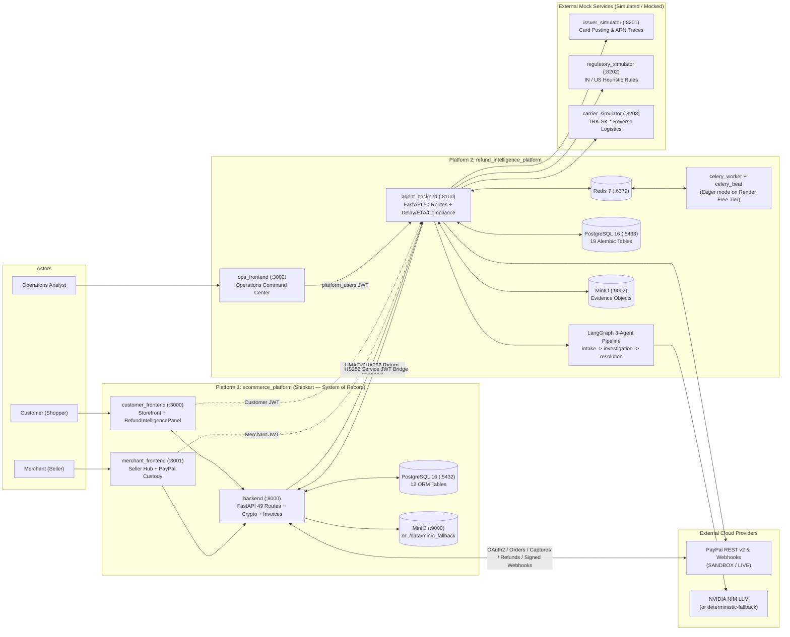
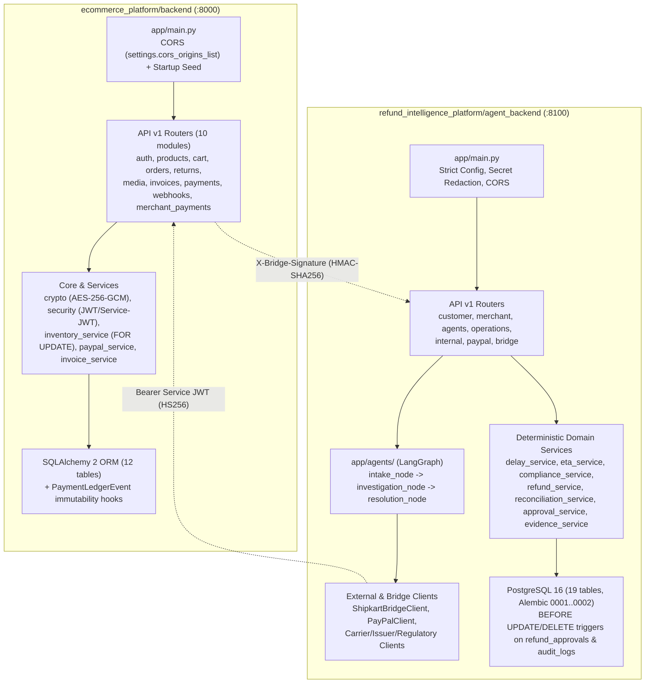
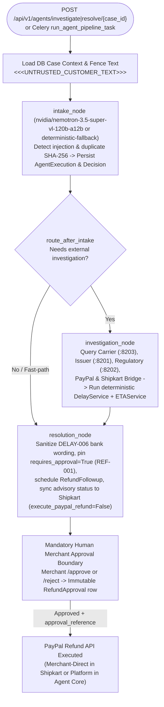
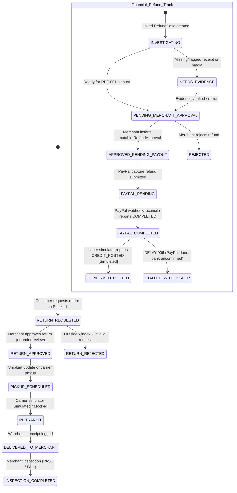
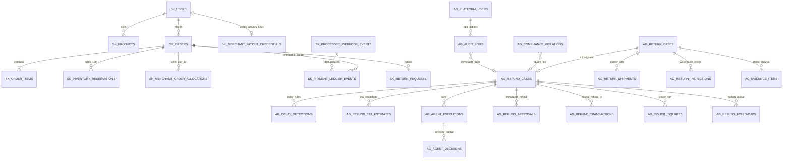
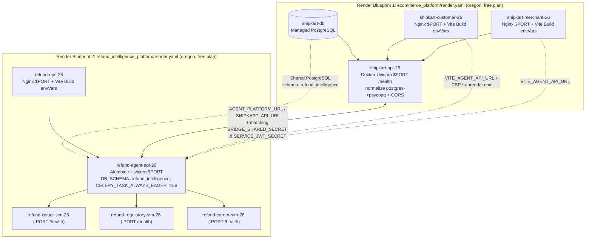

# Shipkart & Agentic Refund Intelligence & Resolution Platform

**Dual-platform workspace uniting the existing PayPal-enabled Shipkart multi-merchant e-commerce application (`ecommerce_platform`) with the companion Agentic Refund Intelligence & Resolution Platform (`refund_intelligence_platform`) for automated evidence gathering, deterministic SLA delay attribution, stage-remaining ETA computation, and human-governed refund resolution.**

> **Platform Documentation:**
> - **Platform 1 — E-Commerce System of Record:** [`ecommerce_platform/README.md`](./ecommerce_platform/README.md) ([API inventory](./ecommerce_platform/docs/analysis/api-inventory.md) · [Feature status](./ecommerce_platform/docs/analysis/feature-status.md) · [Constraints](./ecommerce_platform/docs/analysis/constraints-assumptions-limitations.md))
> - **Platform 2 — Refund Intelligence & Resolution Agent Platform:** [`refund_intelligence_platform/README.md`](./refund_intelligence_platform/README.md) ([API inventory](./refund_intelligence_platform/docs/analysis/api-inventory.md) · [Feature status](./refund_intelligence_platform/docs/analysis/feature-status.md) · [Constraints](./refund_intelligence_platform/docs/analysis/constraints-assumptions-limitations.md))

---

## Contents

1. [Live Cloud Deployment & Reviewer Access](#live-cloud-deployment--reviewer-access)
2. [Overview](#overview)
3. [Problem Statement](#problem-statement)
4. [Motivation and Real-World Context](#motivation-and-real-world-context)
5. [Goals and Non-Goals](#goals-and-non-goals)
6. [Proposed Solution](#proposed-solution)
7. [Verified Feature Matrix](#verified-feature-matrix)
8. [End-to-End Cross-Platform Workflow](#end-to-end-cross-platform-workflow)
9. [Combined System Architecture Diagram](#combined-system-architecture-diagram)
10. [Backend Architecture Diagram](#backend-architecture-diagram)
11. [Agent Architecture Diagram](#agent-architecture-diagram)
12. [Refund Lifecycle Diagram](#refund-lifecycle-diagram)
13. [End-to-End Sequence Diagram](#end-to-end-sequence-diagram)
14. [Database ER and Cross-Platform Data Model Diagram](#database-er-and-cross-platform-data-model-diagram)
15. [Deployment Diagram (Docker Compose and Dual Render Blueprints)](#deployment-diagram-docker-compose-and-dual-render-blueprints)
16. [Agent Responsibilities and Decision Boundaries](#agent-responsibilities-and-decision-boundaries)
17. [Technology Stack with Verified Versions](#technology-stack-with-verified-versions)
18. [Repository Structure](#repository-structure)
19. [API Surface Overview](#api-surface-overview)
20. [Database Ownership and Cross-Platform Linkage](#database-ownership-and-cross-platform-linkage)
21. [PayPal Integration Architecture and Limitations](#paypal-integration-architecture-and-limitations)
22. [Configuration and Environment Variables](#configuration-and-environment-variables)
23. [Installation and Local Setup](#installation-and-local-setup)
24. [Run Instructions (Docker Compose, Local, and Render Blueprints)](#run-instructions-docker-compose-local-and-render-blueprints)
25. [Test, Lint, and Build Verification](#test-lint-and-build-verification)
26. [Security and Privacy Controls](#security-and-privacy-controls)
27. [Constraints, Assumptions, and Limitations](#constraints-assumptions-and-limitations)
28. [Troubleshooting](#troubleshooting)
29. [Future Scope](#future-scope)
30. [License](#license)

---

## Live Cloud Deployment & Reviewer Access

All user-facing portals for both platforms are live on Render and wired together across the dual-Blueprint deployment.

### Public Live URLs (Render Free Tier)

| Portal | Service Name | Live URL | Platform |
|---|---|---|---|
| **Shipkart Customer Storefront** | `shipkart-customer-26` | https://shipkart-customer-26.onrender.com/ | `ecommerce_platform` |
| **Shipkart Merchant Seller Hub** | `shipkart-merchant-26` | https://shipkart-merchant-26.onrender.com/ | `ecommerce_platform` |
| **Refund Operations Console** | `refund-ops-26` | https://refund-ops-26.onrender.com/ | `refund_intelligence_platform` |

> **Render Free Tier Cold-Start Note:** All services are hosted on the **Render Free Tier** and automatically spin down to sleep after inactivity (~15 min). On first load after idle, please allow **30–60+ seconds** for the backend and frontend instances to wake up before retrying or refreshing.

### Reviewer Demo Accounts

| Role / Portal | Service | Email | Password |
|---|---|---|---|
| **Customer Account** | `shipkart-customer-26` | `logith@gmail.com` | `logith@gmail.com` |
| **Seller / Merchant Account** | `shipkart-merchant-26` | `nava@gmail.com` | `nava@gmail.com` |
| **Operations Console Account** | `refund-ops-26` | `ops@shipkart.com` | `ops@shipkart.com` |

> **Account Registration Note:** Reviewers can also register new **Customer** and **Seller (Merchant)** accounts freely from the Shipkart Customer Storefront (`shipkart-customer-26`) and Merchant Seller Hub (`shipkart-merchant-26`) signup screens. **Operations (`ops`) accounts are restricted/admin-managed**—public self-registration is disabled for `refund-ops-26`, so please use `ops@shipkart.com` above to sign in to the Operations Console.

---

## Overview

This repository organizes two decoupled yet tightly integrated services that preserve clean boundaries between **commercial transactions** and **agentic refund intelligence**:

1. **`ecommerce_platform` (Shipkart Marketplace — System of Record):**
   - **Customer Storefront (`customer_frontend`, React 18 / Vite 5, `:3000`)** and **Merchant Seller Hub (`merchant_frontend`, React 18 / Vite 5, `:3001`)**.
   - **Commerce Core API (`backend`, FastAPI, `:8000`)** backed by PostgreSQL 16 (with SQLite local fallback) and MinIO object storage (`product-images`, `invoices`, `return-evidence`, plus `./data/minio_fallback`).
   - Owns catalog listings, carts, 15-minute `InventoryReservation` holds, `STANDARD_CHECKOUT` and Merchant-Direct `PAYPAL_SANDBOX` checkouts, AES-256-GCM encrypted merchant PayPal credentials, 6-step PayPal webhook verification, ReportLab PDF invoices, append-only `PaymentLedgerEvent` records, and return state persistence. Hosts **zero internal LLM/LangGraph agents**.
2. **`refund_intelligence_platform` (Agentic Refund Intelligence & Resolution Platform):**
   - **Agent Core API (`agent_backend`, FastAPI, `:8100`)** + **Celery Worker / Beat** (backed by PostgreSQL 16 with Alembic migrations `0001`–`0002`, Redis 7, MinIO evidence buckets).
   - **LangGraph 3-Agent Orchestrator (`intake_node` → `investigation_node` → `resolution_node`)** using NVIDIA NIM (`nvidia/nemotron-3.5-super-vl-120b-a12b`) with deterministic offline fallback (`deterministic-fallback`).
   - **Deterministic Policy, Delay & ETA Engines:** Evaluates `DELAY-001`..`DELAY-006`, stage-remaining ETA bands, SHA-256 evidence validation, and hard financial/RBAC rules (`REF-001`..`REF-004`, `AUTH-001`/`AUTH-002`, `QTY-001`, `CASE-001`, `DATA-001`, `PAY-002`).
   - **Operations Command Center (`ops_frontend`, React 18 / TypeScript / Vite 5, `:3002`)** authenticated separately via `platform_users`.
   - **Three Standalone `Simulated / mocked` Downstream Services:** `issuer_simulator` (`:8201`), `regulatory_simulator` (`:8202`), and `carrier_simulator` (`:8203`).

Both platforms deploy locally via separate `docker-compose.yml` stacks or to Render via **two coordinated Render Blueprints**: [`ecommerce_platform/render.yaml`](./ecommerce_platform/render.yaml) and [`refund_intelligence_platform/render.yaml`](./refund_intelligence_platform/render.yaml).

---

## Problem Statement

Returning an item and waiting for money back breaks down across fragmented boundaries that traditional e-commerce portals treat as a single opaque status:

1. **Multi-Party Handoff Blind Spots:** Refunds traverse customers, merchants, reverse-logistics carriers, payment gateways (PayPal), issuing banks, and regional rules (India / US). A delay at any boundary stalls settlement without clear owner attribution.
2. **Conflation of Physical Returns and Financial Settlement:** Buyers cannot tell whether a delay comes from uncollected pickup, stalled warehouse inspection, merchant review backlog, PayPal capture linkage, or post-PayPal card-issuer posting lag (`DELAY-006`).
3. **Merchant Payment Credential Isolation:** In multi-merchant marketplaces, routing payments cleanly to individual sellers without exposing raw PayPal secrets or cross-tenant records requires encrypted secret custody and scoped webhooks.
4. **AI Safety & Financial Authority Risk:** An AI agent that investigates returns must be prevented from autonomously executing payment-rail refunds (`REF-001`) or overriding deterministic policy and inventory rules.

---

## Motivation and Real-World Context

Because PayPal does not support domestic `INR`-to-`INR` transactions between Indian buyer and seller accounts, Shipkart cleanly separates catalog display currency (`INR`) from explicit Sandbox payment/refund settlement pricing (`USD`). Extending Shipkart with an external `refund_intelligence_platform` rather than replacing Shipkart's transaction core mirrors enterprise engineering constraints:

- Shipkart stays authoritative for orders, stock reservations, merchant PayPal keys, and ledger events.
- Embedded React intelligence panels inside both `customer_frontend` and `merchant_frontend` query `agent_backend` (`:8100`) directly while internal analysts use the isolated Operations Console (`:3002`).
- Every external downstream dependency not backed by a real live institution (card issuer bank status, shipping carrier scans, India/US compliance rules) is explicitly isolated in standalone `Simulated / mocked` simulators so failures and edge cases can be reproduced deterministically.

---

## Goals and Non-Goals

### Goals
- Preserve `ecommerce_platform` as the system of record for products, buyers, sellers, orders, inventory locks, and Merchant-Direct PayPal credentials.
- Connect both platforms non-invasively via `HMAC-SHA256` webhooks (`X-Bridge-Signature`), `HS256` Service JWTs (`iss=refund-intelligence-platform`), and indexed cross-platform integer foreign references (`shipkart_order_id`, `shipkart_return_id`, `shipkart_customer_id`, `shipkart_merchant_id`).
- Enforce hard human-approval and financial safety rails (`REF-001`..`REF-004`) so LLM agents remain advisory only.
- Deliver dual-platform local orchestration (`docker-compose.yml`) and verified dual-Blueprint Render cloud deployment (`render.yaml`).

### Non-Goals
- **No direct bank or card-issuer settlement control:** Initiating a PayPal refund or logging PayPal `COMPLETED` does not guarantee or trigger bank card posting; issuing bank status is simulated (`:8201`).
- **No live carrier/logistics integration:** Pickup, transit, and delivery milestones are updated manually in Shipkart (`ecommerce_platform`) or simulated via `carrier_simulator` (`:8203`).
- **No certified regulatory/legal/PCI compliance:** Regulatory rules (`:8202`) are software heuristics with non-legal-advice disclaimers; buyers enter card details only inside hosted PayPal JS SDK buttons.
- **No proactive outbound customer notifications:** Updates are fetched via REST polling in UI panels rather than email/SMS/push.

---

## Proposed Solution

```text
Customer / Merchant UIs (Shipkart :3000 / :3001)
   ├── Commerce & PayPal Checkout/Capture ──▶ ecommerce_platform/backend (:8000) ──▶ PayPal REST v2 & Webhook Verify
   │                                                  │            ▲
   │                                  HMAC Webhook ───┤            ├── Service-JWT Bridge Read & REF-001 Guard
   ▼                                                  ▼            │
Intelligence Panels & Ops Console (:3002) ──▶ refund_intelligence_platform/agent_backend (:8100)
                                                      │
                                        ┌─────────────┼──────────────┐
                                        ▼             ▼              ▼
                             LangGraph 3-Agent   Deterministic    3 Simulators
                             (NIM + Fallback)    SLA/ETA/REF      (:8201/:8202/:8203)
```

---

## Verified Feature Matrix

| Capability | Owner Platform | Status | Code Evidence |
|---|---|---|---|
| **Multi-Merchant Catalog, Auth & Cart** | `ecommerce_platform` | `Implemented — verified` | `auth.py`, `products.py`, `cart.py`, `security.py` |
| **Inventory Reservations (`SELECT FOR UPDATE` / 15m TTL)** | `ecommerce_platform` | `Implemented — verified` | `inventory_service.py` (`test_paypal_sandbox.py`) |
| **Merchant-Direct PayPal Vault (AES-256-GCM) & Checkout** | `ecommerce_platform` | `Implemented — verified` *(live Sandbox calls not run)* | `crypto.py`, `merchant_payments.py`, `payments.py`, `PayPalCheckoutButton.jsx` |
| **6-Step Signed PayPal Webhooks & Append-Only Ledger** | `ecommerce_platform` | `Implemented — verified` *(mocked HTTP)* | `webhooks.py`, `models.py` (`PaymentLedgerEvent`) |
| **Shipkart ↔ Agent HMAC / Service-JWT Bridge** | Both Platforms | `Implemented — verified` | `returns.py`, `bridge/routes.py`, `shipkart_bridge.py` |
| **Return & Refund Lifecycle State Machines + Immutability** | `refund_intelligence_platform` | `Implemented — verified` | `models.py`, `0001_initial_schema.py`, `return_service.py`, `compliance_service.py` |
| **Deterministic Delay (`DELAY-001`..`006`) & ETA Engine** | `refund_intelligence_platform` | `Implemented — verified` | `delay_service.py`, `eta_service.py` |
| **Evidence Upload (Magic Bytes, 10MB, SHA-256 Dedup)** | `refund_intelligence_platform` | `Implemented — verified` *(MinIO live server not run)* | `evidence_service.py` (`test_evidence_and_chat.py`) |
| **LangGraph 3-Agent Orchestrator & Injection Fencing** | `refund_intelligence_platform` | `Implemented — verified` *(live NIM not run)* | `agents/graph.py`, `nodes.py`, `test_three_agent_graph.py` |
| **Human Merchant Approval Gate (`REF-001`)** | Both Platforms | `Implemented — verified` | `returns.py` (`/agent-decision` blocks payout), `approval_service.py` |
| **PayPal Refund API Execution & Reconciliation (`PAY-002`)** | Both Platforms | `Partially implemented` / `Implemented — not runtime-verified` | Shipkart Seller Hub executes Merchant-Direct payouts locally after `agent_backend` records `RefundApproval`; `/payments/paypal/refund` on `agent_backend` injects global `PayPalClient`. |
| **Issuer / Bank, Carrier & Regulatory Simulators** | `refund_intelligence_platform` | `Simulated / mocked` | `simulators/issuer_simulator`, `carrier_simulator`, `regulatory_simulator` (`:8201`–`:8203`) |
| **Simulated Clock & Periodic Celery Beat Sweeps** | `refund_intelligence_platform` | `Partially implemented` / `Simulated / mocked` | Injectable timestamps (`as_of`, `estimated_from`) & simulator `/advance`; disabled in Render free tier (`CELERY_TASK_ALWAYS_EAGER=true`). |
| **Customer Proactive Alerts (Email / SMS / Push)** | Workspace | `Not found` | Customer views updates via REST polling inside UI panels. |

---

## End-to-End Cross-Platform Workflow

1. **Catalog & Checkout (`ecommerce_platform`):** A buyer logs into `customer_frontend` (`:3000`), adds INR-priced items (with explicit USD Sandbox pricing), and checks out sequentially per merchant via `Standard Checkout` (`STANDARD_CHECKOUT`) or `Merchant-Direct PayPal` (`MERCHANT_DIRECT` / `PLATFORM_SANDBOX`). `payments.py` reserves stock for 15 minutes, verifies capture amounts with `Decimal`, and writes an immutable `PaymentLedgerEvent` plus a ReportLab PDF tax invoice.
2. **Return Initiation & Bridge Sync (`ecommerce_platform` → `refund_intelligence_platform`):** Buyer opens a return (`POST /api/v1/returns/`) and uploads images/receipts. Shipkart persists `ReturnRequest` and emits an `HMAC-SHA256` webhook (`X-Bridge-Signature`) to `POST /api/v1/bridge/shipkart/return-event`, provisioning a paired `ReturnCase`, `RefundCase`, and initial deterministic ETA in `agent_backend` (`:8100`).
3. **Evidence Verification (`refund_intelligence_platform`):** Additional buyer evidence uploaded to `POST /api/v1/returns/{id}/evidence` undergoes magic-byte MIME inspection, 10 MB size checks, SHA-256 deduplication, and Pillow dimension parsing before storage in private MinIO evidence buckets (or `InMemoryObjectStorage` in tests).
4. **3-Agent Investigation (`intake_node` → `investigation_node` → `resolution_node`):** `agent_backend` (via Celery or synchronous eager call) queries Shipkart capture/refund context via `HS256` Service JWT alongside the simulated Carrier (`:8203`), Issuer (`:8201`), and Regulatory (`:8202`) APIs, computes deterministic `DELAY-001`..`006` rules and remaining-stage ETAs, produces an advisory `AgentDecision` (`requires_approval=True`), and relays advisory notes back to Shipkart (`execute_paypal_refund=false`).
5. **Warehouse Inspection & Mandatory Human Approval (`REF-001`):** After simulated carrier delivery (`DELIVERED_TO_MERCHANT`) and merchant inspection (`PASS`/`FAIL`), a merchant explicitly approves or rejects in Seller Hub / `agent_backend` (`/approve`), writing an append-only `RefundApproval` row.
6. **Authorized Payout & Post-PayPal Tracking (`DELAY-006`):** Shipkart executes the Merchant-Direct PayPal capture refund (or Platform PayPal endpoint in `agent_backend`) using `order.paypal_currency` (`USD`). `issuer_simulator` continues tracking post-PayPal bank posting so unconfirmed bank credit is never mislabeled as final settled cash.

---

## Combined System Architecture Diagram



---

## Backend Architecture Diagram



---

## Agent Architecture Diagram



---

## Refund Lifecycle Diagram



---

## End-to-End Sequence Diagram

```mermaid
sequenceDiagram
    autonumber
    actor Customer
    actor Merchant
    participant SkUI as Shipkart Frontend (:3000 / :3001)
    participant SkAPI as Shipkart Backend (:8000)
    participant PayPal as PayPal REST API
    participant AgAPI as Agent Core (:8100)
    participant LG as LangGraph + Determinism
    participant Sims as Issuer / Carrier / Reg Sims

    Customer->>SkUI: Checkout & pay in USD (INR display)
    SkUI->>SkAPI: POST /api/v1/payments/paypal/create-order & capture-order
    SkAPI->>PayPal: Create & capture order via Merchant-Direct or Platform key
    PayPal-->>SkAPI: CAPTURE COMPLETED + capture_id

    Customer->>SkUI: Request return + upload evidence
    SkUI->>SkAPI: POST /api/v1/returns/
    SkAPI-->>AgAPI: POST /api/v1/bridge/shipkart/return-event (HMAC-SHA256)
    AgAPI->>AgAPI: Create ReturnCase + RefundCase + initial ETA

    AgAPI->>LG: Trigger 3-Agent Pipeline (intake -> investigation -> resolution)
    LG->>SkAPI: GET /orders/{id}/paypal-capture-status (Service JWT)
    LG->>Sims: Fetch Carrier scan, Issuer posting, IN/US heuristics [Simulated]
    LG->>AgAPI: Run DelayService (DELAY-001..006) & ETAService
    LG-->>SkAPI: POST /returns/{id}/agent-decision (execute_paypal_refund=false, REF-001)

    Merchant->>SkUI: Review dossier & approve refund
    SkUI->>AgAPI: POST /api/v1/merchant/refunds/{id}/approve (writes RefundApproval)
    SkUI->>SkAPI: Execute approved Merchant-Direct refund + approval_reference
    SkAPI->>PayPal: POST /v2/payments/captures/{id}/refund (USD)
    PayPal-->>AgAPI: Webhook / Poll -> PAYPAL_COMPLETED
    Note over AgAPI,Sims: Bank posting not forced; DELAY-006 warns if Issuer != CREDIT_POSTED
```

---

## Database ER and Cross-Platform Data Model Diagram

`ecommerce_platform` (12 tables) and `refund_intelligence_platform` (19 tables) run in **separate databases** linked only by integer cross-platform reference IDs (`shipkart_*`).



---

## Deployment Diagram (Docker Compose and Dual Render Blueprints)

This workspace defines two independent containerized deployments: local Docker Compose stacks for development and two Render Blueprint files ([`ecommerce_platform/render.yaml`](./ecommerce_platform/render.yaml) + [`refund_intelligence_platform/render.yaml`](./refund_intelligence_platform/render.yaml)) deployed from the monorepo root.



---

## Agent Responsibilities and Decision Boundaries

| Component | Type | Input & Access | Output | State Mutation & Human Boundary |
|---|---|---|---|---|
| **Delay & ETA Engines** (`delay_service.py`, `eta_service.py`) | Deterministic Python | Database timestamps, shipment scans, issuer & PayPal states | `DELAY-001`..`006` owner attribution + hour windows | Writes `DelayDetection`, `RefundEtaEstimate`. Zero external payout authority. |
| **Compliance Guardrails** (`compliance_service.py`) | Deterministic Python | Case, approval rows, capture links, amounts | Guard pass/fail + `ComplianceViolation` rows | Hard-enforces `REF-001`..`REF-004`, `QTY-001`, `CASE-001`. |
| **`intake_node`** | LangGraph Node (NIM / Fallback) | Fenced customer text & evidence metadata | Intent classification + prompt-injection flags | Persists `AgentExecution` / `AgentDecision` only. Cannot approve refunds. |
| **`investigation_node`** | LangGraph Node (NIM / Fallback) | Bridge read tools + 3 simulators + `DelayService`/`ETAService` | Root-cause synthesis & supporting summary | Read-only external probes; invokes deterministic engines. |
| **`resolution_node`** | LangGraph Node (NIM / Fallback) | Investigation findings | Advisory action (`requires_approval=True`) + chat copy | Sets `execute_paypal_refund=False` (`REF-001`). Never writes `RefundApproval`. |
| **Human Merchant Review** | UI + API Action | Merchant Seller Hub (`/approve`) | Immutable `RefundApproval` + payout trigger | Sole authority permitted to move funds via PayPal REST. |

---

## Technology Stack with Verified Versions

| Layer | Technologies & Minimum Versions Verified in Manifests | Where Used |
|---|---|---|
| **Backend Frameworks** | Python `3.12`, FastAPI `>=0.115.0`, Uvicorn `>=0.30.0`, Pydantic `>=2.8.0` / `pydantic-settings >=2.4.0` | `ecommerce_platform/backend`, `refund_intelligence_platform/agent_backend`, `simulators/*` |
| **Databases & ORM** | PostgreSQL `16` (`postgres:16-alpine`), SQLAlchemy `>=2.0.30`, Alembic `>=1.13.0`, `psycopg[binary] >=3.2.0` | Both platforms (Allembic in `agent_backend`; SQLite in unit/local tests) |
| **AI / Agent Stack** | `langgraph >=0.2.0`, `langchain-core >=0.3.0`, `langchain-nvidia-ai-endpoints >=0.3.0` | `refund_intelligence_platform/agent_backend/app/agents/` |
| **Async / Storage / Security** | `celery >=5.4.0`, Redis `7`, MinIO `>=7.2.7`, `cryptography >=43.0.0`, `pyjwt[crypto] >=2.9.0`, `bcrypt >=4.0.1`, `reportlab >=4.2.0`, `pillow >=10.4.0`, `httpx >=0.27.0` | Both backends |
| **Frontend Portals** | React `^18.3.1`, Vite `^5.4.11`, Tailwind CSS `^3.4.15`, `react-router-dom ^6.28.0`, `lucide-react ^0.460.0`, TypeScript `^5.6.3` (`ops_frontend`), Nginx (`nginx:alpine`) | `customer_frontend`, `merchant_frontend`, `ops_frontend` |

---

## Repository Structure

```text
.
├── README.md                                  # Overall combined workspace documentation (this file)
├── LICENSE                                    # MIT License
├── ecommerce_platform/                        # Platform 1: Shipkart marketplace (System of Record)
│   ├── README.md                              # Standalone Shipkart documentation
│   ├── docker-compose.yml                     # 5-service Compose stack (PG16, MinIO, API, Customer UI, Merchant UI)
│   ├── render.yaml                            # Render Blueprint 1 (shipkart-db, shipkart-api-26, 2 SPAs)
│   ├── backend/                               # FastAPI core (49 routes), AES-256-GCM custody, PayPal & bridge
│   ├── customer_frontend/                     # React SPA (:3000) + PayPal JS SDK + RefundIntelligencePanel
│   ├── merchant_frontend/                     # React SPA (:3001) + Seller PayPal settings + return review
│   └── docs/                                  # Mermaid architecture sources (.mmd) & analysis reports
└── refund_intelligence_platform/              # Platform 2: Agentic Refund Intelligence & Resolution Platform
    ├── README.md                              # Standalone Agent Platform documentation
    ├── docker-compose.yml                     # 10-service Compose stack (PG16, Redis7, MinIO, API, Worker/Beat, 3 Sims, Ops UI)
    ├── render.yaml                            # Render Blueprint 2 (agent-api-26, ops-26, 3 sims; shares shipkart-db via DB_SCHEMA=refund_intelligence)
    ├── agent_backend/                         # FastAPI (50 routes), LangGraph 3-agent core, Alembic migrations, Celery
    ├── ops_frontend/                          # React + TypeScript Operations Console (:3002, 9 pages)
    ├── simulators/                            # 3 standalone FastAPI mock services (issuer :8201, regulatory :8202, carrier :8203)
    └── docs/                                  # Mermaid architecture sources (.mmd) & analysis reports
```

---

## API Surface Overview

Detailed route-by-route tables (methods, auth dependencies, schemas, and side effects) are maintained in:
- [`ecommerce_platform/docs/analysis/api-inventory.md`](./ecommerce_platform/docs/analysis/api-inventory.md) (**49 routes** across `/health` and `/api/v1/*`)
- [`refund_intelligence_platform/docs/analysis/api-inventory.md`](./refund_intelligence_platform/docs/analysis/api-inventory.md) (**50 routes** in `agent_backend` + simulator routes)

Key cross-platform endpoints linking the two services:

| Direction | Endpoint | Auth Mechanism | Purpose |
|---|---|---|---|
| `ecommerce_platform` → `refund_intelligence_platform` | `POST /api/v1/bridge/shipkart/return-event` | `HMAC-SHA256` (`X-Bridge-Signature`) | Syncs return creation/status changes to provision/update `ReturnCase` + `RefundCase` |
| `refund_intelligence_platform` → `ecommerce_platform` | `GET /api/v1/orders/{id}/bridge-context`, `GET /api/v1/orders/{id}/paypal-capture-status`, `GET /api/v1/returns/{id}/paypal-refund-status` | `HS256` Service JWT | Read-only order, Merchant-Direct PayPal capture/refund state retrieval |
| `refund_intelligence_platform` → `ecommerce_platform` | `POST /api/v1/returns/{id}/agent-decision` | `HS256` Service JWT | Posts advisory agent findings; `REF-001` rejects `execute_paypal_refund=true` |
| Merchant Seller Hub (`:3001`) → `agent_backend` (`:8100`) → `sk_backend` (`:8000`) | `POST /api/v1/merchant/refunds/{id}/approve` then `POST /api/v1/returns/{id}/execute-approved-refund` | Merchant JWT + Service JWT / Approval ref | Records immutable `RefundApproval` then triggers PayPal refund inside Shipkart |

---

## Database Ownership and Cross-Platform Linkage

| Database | Platform | Tables & Migration Method | Key Tables & Guarantees |
|---|---|---|---|
| `shipkart` (PostgreSQL `:5432`) | `ecommerce_platform` | **12 tables** created via SQLAlchemy `Base.metadata.create_all` + additive `ensure_schema_columns` | `users`, `addresses`, `products`, `merchant_payout_credentials`, `cart_items`, `orders`, `order_items`, `inventory_reservations`, `merchant_order_allocations`, `payment_ledger_events` (append-only hooks), `processed_webhook_events`, `return_requests`. |
| `refund_intelligence` (PostgreSQL `:5433`) | `refund_intelligence_platform` | **19 tables** managed by **Alembic** (`0001_initial_schema.py`, `0002_platform_users.py`) | `return_cases`, `refund_cases`, `refund_approvals` (DB trigger immutable), `audit_logs` (DB trigger immutable), `agent_executions`, `agent_decisions`, `evidence_items`, `delay_detections`, `refund_eta_estimates`, `refund_transactions`, `issuer_inquiries`, `platform_users`, etc. |

Both `backend/app/core/config.py` and `agent_backend/app/core/config.py` normalize `postgres://` and `postgresql://` connection strings (such as Render `fromDatabase.connectionString`) automatically to `postgresql+psycopg://` for `psycopg` v3 compatibility.

---

## PayPal Integration Architecture and Limitations

- **Supported Checkout & Refund Modes:**
  - `MERCHANT_DIRECT`: Seller saves their own PayPal Client ID, encrypted Secret (`AES-256-GCM` with per-merchant AAD), and optional Webhook ID in Seller Hub (`:3001`). Customer checkout loads that seller's `client-id`; refunds execute via that seller's credentials.
  - `PLATFORM_SANDBOX`: Applies only to starter catalog products (`merchant_id IS NULL`); never silently substitutes for unconfigured merchants (`HTTP 503`).
  - `STANDARD_CHECKOUT` / `CAP-SIM-*`: Uses simulated local confirmation and synthetic `SK-REF-*` transaction IDs without calling PayPal.
- **Explicit Distinction Between PayPal Initiation and Bank Settlement:** Calling `/v2/payments/captures/{capture_id}/refund` or receiving PayPal `COMPLETED` means PayPal processed the refund instruction; downstream bank card posting (`DELAY-006`) is tracked separately and currently backed only by `issuer_simulator` (`Simulated / mocked`).
- **Signature Verification Caveat:** In `refund_intelligence_platform`, `POST /api/v1/webhooks/paypal` skips signature verification when `ENVIRONMENT` is local/dev/test and `PAYPAL_WEBHOOK_ID` is unset. In `ecommerce_platform`, missing webhook ID fails verification unless running explicitly mocked test fixtures.

---

## Configuration and Environment Variables

Use environment-variable names only; never commit populated secrets. Both `.env.example` files serve as safe starting templates.

| Variable Group | Variables | Used By | Purpose |
|---|---|---|---|
| **Databases** | `DATABASE_URL` | `sk_backend`, `agent_backend` | Auto-injected on Render via `fromDatabase`; auto-normalized from `postgresql://` to `postgresql+psycopg://`. |
| **Shared Auth & Bridge** | `SECRET_KEY` (`sk_backend`) **==** `JWT_SECRET_KEY` (`agent_backend`), `BRIDGE_SHARED_SECRET`, `SERVICE_JWT_SECRET`, `SERVICE_JWT_ISSUER` | Both backends | **Must match identically** across both services/Render blueprints so `agent_backend` verifies buyer/seller JWTs and HMAC/Service-JWT calls succeed. |
| **Vault & Ops Admin** | `APP_DATA_ENCRYPTION_KEY` (`sk_backend`), `PLATFORM_ADMIN_EMAIL` & `PLATFORM_ADMIN_PASSWORD` (`agent_backend`) | Backends | 32-byte key for AES-256-GCM merchant PayPal custody; initial Ops Console account bootstrap. |
| **Cross-Service URLs** | `AGENT_PLATFORM_URL` (`sk_backend`), `SHIPKART_API_URL` (`agent_backend`), `CORS_ORIGINS` | Both backends | Public URLs linking Render Blueprints 1 and 2, plus frontend CORS origin allowlists. |
| **PayPal REST** | `PAYPAL_CLIENT_ID`, `PAYPAL_CLIENT_SECRET`, `PAYPAL_WEBHOOK_ID`, `PAYPAL_ENV` | Both backends | Optional fallback/platform REST credentials (`SANDBOX` or `LIVE`). |
| **AI & Async Workers** | `NVIDIA_API_KEY`, `CELERY_TASK_ALWAYS_EAGER`, `REDIS_URL`, `ISSUER_SIMULATOR_URL`, `REGULATORY_SIMULATOR_URL`, `CARRIER_SIMULATOR_URL` | `agent_backend`, Celery | Enables NVIDIA NIM (`deterministic-fallback` if empty), eager vs Celery/Redis execution, and simulator endpoints. |
| **Object Storage** | `MINIO_ENDPOINT`, `MINIO_PUBLIC_URL`, `MINIO_ACCESS_KEY`, `MINIO_SECRET_KEY`, `MINIO_SECURE` | Both backends | If `MINIO_ENDPOINT` is empty, `sk_backend` falls back cleanly to `./data/minio_fallback`; `agent_backend` requires valid external S3/MinIO credentials for persisted evidence uploads. |
| **Frontend Build Args** | `VITE_API_URL`, `VITE_AGENT_API_URL`, `VITE_OPS_CONSOLE_URL` | 3 Vite frontends | Passed at Docker build time via `envVars` on Render or `build.args` in Docker Compose. |

---

## Installation and Local Setup

### Prerequisites
- Docker Engine / Desktop with Compose v2 (for containerized multi-service setup), **or**
- Python `3.12+` and Node.js `v20+` / `v24.15.0` (verified versions in this environment).

### Prepare Environment Files
```bash
# 1. E-Commerce Platform env
cd ecommerce_platform
cp .env.example .env
python -c "import os, base64; print(base64.b64encode(os.urandom(32)).decode())"  # -> APP_DATA_ENCRYPTION_KEY

# 2. Refund Intelligence Platform env
cd ../refund_intelligence_platform
cp .env.example .env
# Ensure SECRET_KEY (ecommerce_platform) == JWT_SECRET_KEY (refund_intelligence_platform),
# and BRIDGE_SHARED_SECRET / SERVICE_JWT_SECRET match across both .env files.
```

---

## Run Instructions (Docker Compose, Local, and Render Blueprints)

### Option A: Docker Compose (Both Platforms Locally)

Start both stacks in two terminals so Shipkart (`:3000`–`:8000`) and Refund Intelligence (`:3002`–`:8203`) communicate over the local host bridge:

```bash
# Terminal 1: Start E-Commerce Platform
cd ecommerce_platform
docker compose up --build -d

# Terminal 2: Start Refund Intelligence Platform + 3 Simulators
cd ../refund_intelligence_platform
docker compose up --build -d
```

Verified local ports:
- Shipkart Customer Storefront: `http://localhost:3000` · Merchant Seller Hub: `http://localhost:3001` · Commerce API: `http://localhost:8000`
- Refund Ops Console: `http://localhost:3002` · Agent Core API: `http://localhost:8100` · Simulators: `:8201`, `:8202`, `:8203`
- PostgreSQL: `:5432` (Shipkart), `:5433` (Refund Agent) · MinIO: `:9000`/`:9001` & `:9002`/`:9003` · Redis: `:6379`

### Option B: Cloud Deployment on Render (Dual Blueprint Setup)

Deploy both Blueprints from the **repository root** as the Render repo context (Render resolves `./ecommerce_platform/...` and `./refund_intelligence_platform/...` paths relative to repo root):

1. **Create Blueprint 1** pointing Render Blueprint Path to `ecommerce_platform/render.yaml` (`shipkart-db`, `shipkart-api-26`, `shipkart-customer-26`, `shipkart-merchant-26`).
2. **Create Blueprint 2** pointing Render Blueprint Path to `refund_intelligence_platform/render.yaml` (`refund-issuer-sim-26`, `refund-regulatory-sim-26`, `refund-carrier-sim-26`, `refund-agent-api-26`, `refund-ops-26`).
   - Because Render Free Tier permits **one** free PostgreSQL database per workspace, `refund-agent-api-26` reuses `shipkart-db`'s **Internal Database URL** for `DATABASE_URL` and sets `DB_SCHEMA=refund_intelligence` so Alembic + SQLAlchemy isolate all 19 agent tables (including `processed_webhook_events`) and triggers inside the `refund_intelligence` schema without colliding with Shipkart's `public` schema.
3. **Configure matching cross-blueprint secrets & URLs (`sync: false`) in Render Dashboard:**
   - Set identical values on `shipkart-api-26` and `refund-agent-api-26` for:
     - `SECRET_KEY` (`shipkart-api-26`) **=** `JWT_SECRET_KEY` (`refund-agent-api-26`)
     - `BRIDGE_SHARED_SECRET`
     - `SERVICE_JWT_SECRET`
   - Cross-link URLs after initial service creation:
     - On `shipkart-api-26`: `AGENT_PLATFORM_URL=https://refund-agent-api-26.onrender.com`
     - On `refund-agent-api-26`: `SHIPKART_API_URL=https://shipkart-api-26.onrender.com`
   - Set `APP_DATA_ENCRYPTION_KEY` on `shipkart-api-26`, `PLATFORM_ADMIN_EMAIL` & `PLATFORM_ADMIN_PASSWORD` (`>= 8` chars) on `refund-agent-api-26`, optional `NVIDIA_API_KEY`, optional PayPal Sandbox credentials, and external S3/MinIO variables if durable object storage is required.

> **Verified Render Safeguards:** Both `render.yaml` files use `envVars` (for Docker `--build-arg` propagation), enforce explicit `CORS_ORIGINS` (`settings.cors_origins_list`), normalize `postgres://` / `postgresql://` URLs to `postgresql+psycopg://`, escape `%` in `alembic/env.py`, skip 15s MinIO retry delays when `MINIO_ENDPOINT` is blank in `sk_backend`, include `https://*.onrender.com` in `customer_frontend/index.html` CSP `connect-src`/`img-src`, and run Celery in `CELERY_TASK_ALWAYS_EAGER="true"` mode with `REDIS_URL=""`.

---

## Test, Lint, and Build Verification

Actual commands executed and observed in this workspace (2026-11-12, Python `3.12.8`, Node `v24.15.0`):

| Platform / Target | Exact Command | Result Observed | Scope & Notes |
|---|---|---|---|
| `refund_intelligence_platform/agent_backend` | `python -m pytest -q` | **Passed (`71 passed`, exit `0`)** | Unit, compliance, API, 3-agent LangGraph graph, and bridge tests using SQLite in-memory DB, `InMemoryObjectStorage`, and mocked PayPal/Shipkart/simulator HTTPX transports. |
| `ecommerce_platform/backend` | `python -m pytest -q` *(clean temp `DATABASE_URL`)* | **Passed (`16 passed`, exit `0`)** | All `test_paypal_sandbox.py` (13) + `test_api_e2e.py` (3) passed on clean DB. *(Running `test_api_e2e.py` against pre-populated local `./data/ecommerce.db` fails `15 passed, 1 failed` if item stock was previously depleted.)* |
| `ecommerce_platform/customer_frontend` | `npm run build` | **Passed (exit `0`)** | Vite `v5.4.21` production build (`2124` modules, built after adding `https://*.onrender.com` to CSP). |
| `ecommerce_platform/merchant_frontend` | `npm run build` | **Passed (exit `0`)** | Vite `v5.4.21` production build (`2114` modules). |
| `ecommerce_platform` Motion Unit Tests | `node --test src/motion/__tests__/math.test.mjs` | **Passed (`4/4` customer, `8/8` merchant)** | Verified frontend animation math utilities. |
| `refund_intelligence_platform/ops_frontend` | `npx tsc --noEmit` | **Passed (exit `0`)** | Strict TypeScript type-check across all 9 Operations Console pages. |
| Linter / `mmdc` Mermaid CLI / Live Cloud Deploy | — | **Not run** | No linter configured; `mmdc` not installed; live Render cloud deployment requires pushing to GitHub & triggering Blueprints. |

---

## Security and Privacy Controls

1. **Zero Card Data Handling:** Buyer payment details are collected strictly by PayPal SDK hosted popups (`https://www.paypal.com/sdk/js`).
2. **AES-256-GCM Secret Vault (`ecommerce_platform`):** Merchant `paypal_client_secret` values are encrypted with 96-bit random nonces and per-merchant AAD (`merchant:{id}:paypal`), never returned after save.
3. **Immutable Audit & Approval Ledgers:** `PaymentLedgerEvent` (Shipkart ORM hooks), `refund_approvals`, and `audit_logs` (PostgreSQL `BEFORE UPDATE OR DELETE` triggers) enforce append-only trails.
4. **Secret Scrubbing & Prompt-Injection Fencing:** `redact_sensitive_data` removes credentials before DB/API logging; `intake_node` wraps buyer text in `<<<UNTRUSTED_CUSTOMER_TEXT>>>` fences and flags injection attempts.
5. **Dual-Plane Auth & Cross-Service Tokens:** Customer/merchant Shipkart JWTs cannot access internal `platform_users` Ops routes; cross-backend calls require short-lived `HS256` Service JWTs or `HMAC-SHA256` webhook signatures.

---

## Constraints, Assumptions, and Limitations

Detailed per-platform inventories are maintained in [`ecommerce_platform/docs/analysis/constraints-assumptions-limitations.md`](./ecommerce_platform/docs/analysis/constraints-assumptions-limitations.md) and [`refund_intelligence_platform/docs/analysis/constraints-assumptions-limitations.md`](./refund_intelligence_platform/docs/analysis/constraints-assumptions-limitations.md). Key workspace-wide items:

- **Simulated Downstream Dependencies:** Bank card posting (`:8201`), India/US regulatory rules (`:8202`), carrier scans (`:8203`), and `STANDARD_CHECKOUT` / `CAP-SIM-*` refunds are `Simulated / mocked`.
- **Render Free-Tier Constraints:** `CELERY_TASK_ALWAYS_EAGER="true"` disables background Celery Beat periodic sweeps on Render free tier unless triggered via `/api/v1/internal/*`; Shipkart image/invoice fallbacks stored on `./data/minio_fallback` are ephemeral across Render container restarts without external S3/MinIO; evidence uploads in `agent_backend` require configured MinIO/S3 credentials.
- **Render Cold Starts & Ephemeral Local Storage:** Free-tier Render web services spin down after inactivity, requiring initial wake-up latency on first request.
- **No `VITE_OPS_CONSOLE_URL` UI Link Rendered:** Build arg is declared in `merchant_frontend`, Compose, and Render specs, though `merchant_frontend/src/` does not render an external console link yet.

---

## Troubleshooting

- **Cross-service auth or bridge fails (`401` / `403`):** Verify `SECRET_KEY` (`ecommerce_platform`) equals `JWT_SECRET_KEY` (`refund_intelligence_platform`), and `BRIDGE_SHARED_SECRET`, `SERVICE_JWT_SECRET`, and `SERVICE_JWT_ISSUER` (`refund-intelligence-platform`) match identically.
- **Customer Portal blocks API requests in browser console on Render:** Confirm `CORS_ORIGINS` on both APIs includes exact `https://shipkart-customer-26.onrender.com` / `https://shipkart-merchant-26.onrender.com` / `https://refund-ops-26.onrender.com` origins and that `customer_frontend/index.html` includes `https://*.onrender.com` in `connect-src` and `img-src`.
- **PayPal Checkout returns `503` ("Merchant has not configured PayPal credentials"):** Product belongs to a merchant (`merchant_id IS NOT NULL`) without saved REST keys; save valid keys in Seller Hub → **Payment Settings**.
- **`test_full_ecommerce_lifecycle` fails locally with `400 == 201`:** Clear stale `./data/ecommerce.db` or pass a fresh temporary `DATABASE_URL` when running `ecommerce_platform/backend` pytest.

---

## Future Scope

- Integrate live carrier webhook ingestion (replacing `:8203` simulator) and certified outbound notification channels (email/SMS/webhooks).
- Hydrate MinIO image bytes (`image_b64`) into `intake_node` in `graph.py` for automated NIM Vision inspection of damaged product photos.
- Wire Seller Hub navigation link using `VITE_OPS_CONSOLE_URL` and add retry/outbox queuing for Shipkart → Agent webhook delivery.
- Add persistent Redis/Celery worker plans and external S3/MinIO object storage for production cloud deployments.

---

## License

Licensed under the [MIT License](./LICENSE) (`Copyright (c) 2026 LOGITH P`).

