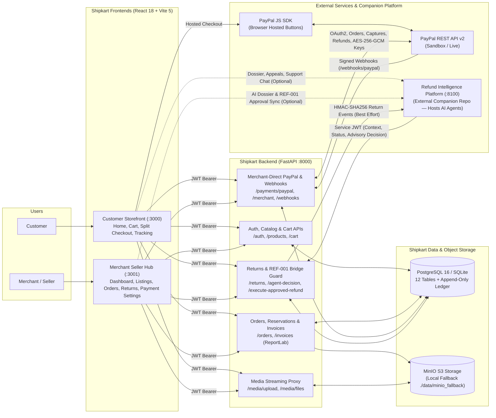
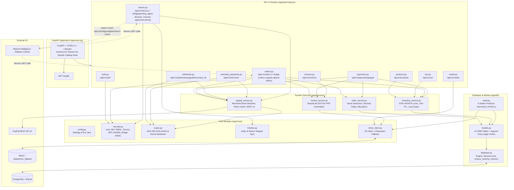
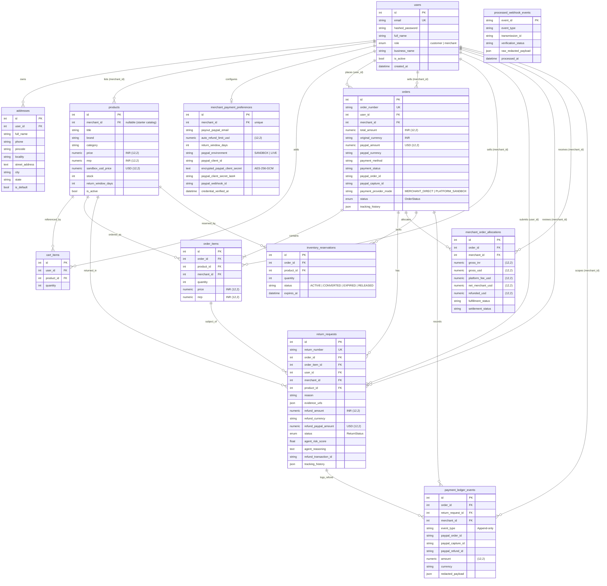
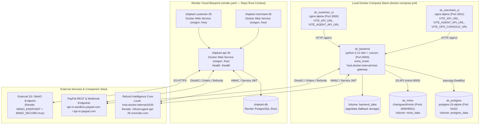

# Shipkart E-Commerce Platform (`ecommerce_platform`)

**Multi-merchant e-commerce marketplace featuring dual React portals, FastAPI transaction core, Merchant-Direct PayPal checkout (`USD` Sandbox settlement alongside `INR` display pricing), time-bounded inventory reservations, immutable payment ledgering, MinIO object storage, and an authenticated HTTP bridge to the companion Refund Intelligence Platform.**

---

## Contents

- [Overview](#overview)
- [Problem Statement](#problem-statement)
- [Motivation and Real-World Context](#motivation-and-real-world-context)
- [Goals and Non-Goals](#goals-and-non-goals)
- [Proposed Solution](#proposed-solution)
- [Verified Feature List with Implementation Status](#verified-feature-list-with-implementation-status)
- [End-to-End Workflow](#end-to-end-workflow)
- [Combined System Architecture Diagram](#combined-system-architecture-diagram)
- [Backend Architecture Diagram](#backend-architecture-diagram)
- [Agent Architecture and Decision Boundaries](#agent-architecture-and-decision-boundaries)
- [Refund Lifecycle Diagram](#refund-lifecycle-diagram)
- [Sequence Diagram](#sequence-diagram)
- [Database ER and Data Model Diagram](#database-er-and-data-model-diagram)
- [Deployment Diagram](#deployment-diagram)
- [Technology Stack with Verified Versions](#technology-stack-with-verified-versions)
- [Repository Structure](#repository-structure)
- [API Reference Summary](#api-reference-summary)
- [Database Model and Relationships](#database-model-and-relationships)
- [Payment-Provider Integration and Limitations](#payment-provider-integration-and-limitations)
- [Configuration and Environment Variables](#configuration-and-environment-variables)
- [Installation and Local Setup](#installation-and-local-setup)
- [Run Instructions](#run-instructions)
- [Test, Lint, and Build Instructions](#test-lint-and-build-instructions)
- [Security and Privacy Controls](#security-and-privacy-controls)
- [Constraints](#constraints)
- [Assumptions](#assumptions)
- [Current Limitations and Known Issues](#current-limitations-and-known-issues)
- [Troubleshooting](#troubleshooting)
- [Future Scope](#future-scope)
- [License](#license)

---

## Overview

`ecommerce_platform` (branded **Shipkart**) is the system-of-record commerce application in a two-platform workspace:

1. **Customer Storefront ([`customer_frontend/`](./customer_frontend)):** A React 18 / Vite 5 single-page application (SPA) running on port `3000` for browsing products, managing addresses and carts, completing either Standard Checkout or Merchant-Direct PayPal Sandbox checkout, tracking orders and returns, downloading tax invoices, and viewing connected return intelligence via `VITE_AGENT_API_URL`.
2. **Merchant Seller Hub ([`merchant_frontend/`](./merchant_frontend)):** A separate React 18 / Vite 5 SPA running on port `3001` for seller analytics, listing management, starter-catalog claiming, item-scoped order fulfillment, return review, Merchant-Direct PayPal credential custody, and per-order USD/INR allocation tracking.
3. **Backend API Core ([`backend/`](./backend)):** A FastAPI REST API on port `8000` backed by PostgreSQL 16 (or SQLite for local standalone development/testing) and MinIO S3-compatible object storage (with local `./data/minio_fallback` storage when MinIO is offline).

> **Important architectural distinction:** `ecommerce_platform` does **not** run any LLM or LangGraph AI agents in-process. AI return investigation, delay detection, and dossier chat execute externally in the companion repository (`../refund_intelligence_platform` on port `8100`) and communicate with Shipkart exclusively over authenticated HTTP bridge endpoints protected by `REF-001` human-approval enforcement.

---

## Problem Statement

Multi-vendor marketplace checkouts and post-purchase return flows commonly break down around four technical failure modes:

- **Shared-account payment ambiguity:** Routing all sellers through a single platform PayPal account blurs merchant settlement accountability unless partner multiparty infrastructure is enrolled.
- **Checkout race conditions:** Decrementing inventory only *after* payment capture allows simultaneous buyers to pay for the last remaining unit.
- **FX spread and refund mismatch:** Displaying catalog prices in `INR` while converting to `USD` dynamically with ad-hoc rates causes refund rounding discrepancies when PayPal Sandbox settles in `USD`.
- **Uncontrolled automated refunds:** Allowing an external AI service to trigger payment-rail payouts autonomously without explicit merchant authorization violates merchant financial controls.

---

## Motivation and Real-World Context

Because PayPal does not support domestic `INR`-to-`INR` transactions between Indian buyer and seller accounts, international/Sandbox integrations settle in currencies such as `USD` while storefronts targeting Indian shoppers display prices in `INR`. Meanwhile, independent marketplace merchants need payments captured directly into their own PayPal accounts without exposing raw API secrets to buyers or external analytics/intelligence services. Shipkart separates catalog display pricing (`INR`), explicit Sandbox settlement pricing (`USD`), encrypted per-merchant PayPal credential storage, and human-gated (`REF-001`) refund execution.

---

## Goals and Non-Goals

### Goals
- Keep `ecommerce_platform` as the authoritative relational and object-storage system of record for users, products, orders, inventory reservations, returns, allocations, and payment ledger events.
- Support independent Merchant-Direct PayPal checkout (`MERCHANT_DIRECT`) using AES-256-GCM encrypted merchant credentials, plus `PLATFORM_SANDBOX` fallback exclusively for unclaimed starter catalog items (`merchant_id IS NULL`).
- Eliminate last-unit overselling during PayPal popup authorization via order-first persistence, PostgreSQL `SELECT ... FOR UPDATE` row locks, and 15-minute `InventoryReservation` holds.
- Enforce exact `Decimal` / `Numeric(12, 2)` monetary math and append-only `PaymentLedgerEvent` records.
- Integrate cleanly with `refund_intelligence_platform` via HMAC-SHA256 signed outbound webhooks and `HS256` Service-JWT inbound APIs while preserving strict `REF-001` merchant approval gates.

### Non-Goals
- Acting as a PayPal Commerce Platform (PPCP) Partner split-payout aggregator in a single PayPal transaction.
- Running live FX currency conversion engines or forcing downstream card-issuer / bank settlement.
- Integrating external shipping carrier / logistics tracking APIs.
- Hosting LLM inference, LangGraph orchestration, or rule-based SLA delay schedulers inside `ecommerce_platform`.

---

## Proposed Solution

Shipkart implements:
1. **Strict Portal Separation:** Separate `customer_frontend` and `merchant_frontend` builds sharing `/api/v1` via role-scoped `HS256` JWTs (`customer` vs `merchant`).
2. **AES-256-GCM Secret Custody:** Sellers enter PayPal REST credentials (`SANDBOX` or `LIVE`) in `/settings/payments`; the backend verifies OAuth2 live, encrypts `client_secret` with `AESGCM` + 96-bit random nonces + per-merchant Associated Authenticated Data (`merchant:{id}:paypal`), and returns only `last4` masks.
3. **Sequential Split-Merchant Cart Checkout:** `GET /api/v1/payments/paypal/client-config` groups multi-merchant carts into separate checkout cards so `PayPalCheckoutButton.jsx` loads one `client-id` at a time into `window.paypal` without script collisions, clearing only the captured merchant's cart items on capture.
4. **6-Step PayPal Webhook Reconciliation:** Platform (`/api/v1/webhooks/paypal`) and merchant-scoped (`/api/v1/webhooks/paypal/{merchant_id}`) endpoints validate `PAYPAL-CERT-URL` (`https://*.paypal.com`), verify cryptographic signatures with PayPal, filter against a 9-event allowlist, deduplicate by `ProcessedWebhookEvent.event_id`, re-fetch authoritative PayPal capture/refund resources, and append ledger events.
5. **REF-001 Refund Guard:** External AI decisions (`POST /api/v1/returns/{id}/agent-decision`) are advisory only and block `execute_paypal_refund=True`; final PayPal refunds execute only through explicit merchant approval (`PATCH /decision` or `POST /execute-approved-refund` with `approval_reference`).

---

## Verified Feature List with Implementation Status

Full evidence and code-to-doc discrepancy notes are documented in [`docs/analysis/feature-status.md`](./docs/analysis/feature-status.md).

| Feature | Status | Summary of Code Evidence |
|---|---|---|
| Customer & Merchant JWT Auth / RBAC | `Implemented — verified` | `HS256` JWT + `bcrypt` hashing + strict `customer`/`merchant`/`service` dependencies (`security.py`, `auth.py`). |
| Multi-Merchant Catalog & Starter Claiming | `Implemented — verified` | Public filter/search, merchant CRUD, `claim` / `claim-starter`, explicit `sandbox_usd_price` (`products.py`, `seed.py`). |
| Standard Checkout (`STANDARD_CHECKOUT`) | `Implemented — verified` | Locks stock, creates confirmed order (`CONFIRMED`), allocation (`STANDARD_CONFIRMED`), and PDF invoice (`orders.py`). |
| Merchant-Direct PayPal Checkout & Capture | `Implemented — verified` | Order-first `create-order`, 15m `InventoryReservation`, ownership/Decimal-verified `capture-order`, split cart (`payments.py`, `PayPalCheckoutButton.jsx`). Live PayPal Sandbox API calls were not executed in this run. |
| AES-256-GCM PayPal Credential Vault | `Implemented — verified` | Per-merchant AAD encryption, live OAuth2 verify, masked `last4`, disconnect (`crypto.py`, `merchant_payments.py`). |
| 6-Step Signed PayPal Webhooks | `Implemented — verified` | Cert URL host validation, `verify-webhook-signature`, 9-event allowlist, `event_id` dedup, authoritative re-fetch (`webhooks.py`). Verified with mocked HTTP. |
| Append-Only Payment Ledger & Allocations | `Implemented — verified` | SQLAlchemy `before_update`/`before_delete` hooks block mutation on `PaymentLedgerEvent`; `MerchantOrderAllocation` tracks USD revenue/refunds (`models.py`). |
| Return Lifecycle & REF-001 Approval Gate | `Implemented — verified` | Proportional USD refunds, 6-stage `ReturnStatus`, `/agent-decision` blocks payout, `/execute-approved-refund` requires `approval_reference` (`returns.py`). |
| MinIO S3 Storage & ReportLab Invoices | `Implemented — not runtime-verified` | `product-images`, `invoices`, `return-evidence` buckets with `./data/minio_fallback` (`minio_client.py`, `invoice_service.py`). Live MinIO server not run here. |
| Evidence Inspection & SLA Delay Detection | `Not found` *(delegated externally)* | Shipkart stores uploaded `evidence_urls`; SHA-256 evidence verification and `DELAY-001`..`DELAY-006` run in `refund_intelligence_platform`. |
| Simulated Payout Fallback (Standard / `CAP-SIM-*`) | `Simulated / mocked` | Standard Checkout and `CAP-SIM-*` captures assign synthetic `SK-REF-*` transaction IDs without contacting PayPal (`returns.py`). |
| Seller Hub Operations Console Link (`VITE_OPS_CONSOLE_URL`) | `Not found` *(in UI source)* | Defined in env files/Docker/Render specs, but unused in `merchant_frontend/src/` (`SellerLayout.jsx`). |

---

## End-to-End Workflow

1. **Merchant Setup:** A seller registers via `POST /api/v1/auth/register` (`role: "merchant"`), claims starter items or creates products (`price` in `INR` + `sandbox_usd_price` in `USD`), and configures PayPal REST credentials in Seller Hub (`/settings/payments`).
2. **Cart & Checkout:** A customer adds products and navigates to Checkout. If the cart mixes multiple sellers (or seller + platform starter catalog), `GET /api/v1/payments/paypal/client-config` partitions items into per-merchant groups (`requires_split_checkout = true`).
3. **Order-First PayPal Capture:** Clicking PayPal triggers `POST /api/v1/payments/paypal/create-order` (creating a `PENDING_PAYMENT` order, 15-minute `InventoryReservation`, and UUID `PayPal-Request-Id` keys before contacting PayPal `/v2/checkout/orders`). After buyer approval, `capture-order` verifies ownership and exact `Decimal` amount/currency, converts the reservation, deducts `Product.stock`, records `CAPTURE_COMPLETED` in `payment_ledger_events`, clears only that merchant's cart items, and generates a PDF invoice (`invoices` bucket).
4. **Fulfillment & Return Initiation:** The merchant advances order status (`ORDERED` → `PACKED` → `SHIPPED` → `OUT_FOR_DELIVERY` → `DELIVERED`). Upon delivery, the customer uploads defect photos (`POST /api/v1/media/upload`) and submits a return (`POST /api/v1/returns/`), calculating proportional `refund_paypal_amount`.
5. **External Bridge & REF-001 Refund Execution:** Shipkart emits an HMAC-SHA256 `RETURN_REQUESTED` event to `refund_intelligence_platform` (`:8100`). External agents read context/evidence via Service JWT and post advisory findings to `POST /api/v1/returns/{id}/agent-decision`, moving the return to `UNDER_REVIEW` while blocking autonomous payout. Once a merchant approves via `execute-approved-refund` (or `PATCH /decision`), Shipkart executes `refund_capture()` using the owning merchant's PayPal credentials (or assigns `SK-REF-*` for Standard/`CAP-SIM-*` orders), reconciles `PAYMENT.CAPTURE.REFUNDED` webhooks, and relays `RETURN_STATUS_UPDATED`.

---

## Combined System Architecture Diagram

Source file: [`docs/architecture/combined-system-architecture.mmd`](./docs/architecture/combined-system-architecture.mmd)

This high-level architecture shows both React SPAs, the FastAPI backend layers, PostgreSQL/MinIO persistence, PayPal REST/JS SDK boundaries, and the external HTTP bridge to the companion Refund Intelligence Platform (`:8100`).



---

## Backend Architecture Diagram

Source file: [`docs/architecture/backend-architecture.mmd`](./docs/architecture/backend-architecture.mmd)

This view details FastAPI routers, security/encryption/storage utilities in `app/core/`, domain services in `app/services/`, SQLAlchemy ORM models, and external I/O boundaries.



---

## Agent Architecture and Decision Boundaries

**No internal AI agents exist in `ecommerce_platform`.** Accordingly, no separate internal agent-orchestrator diagram is drawn for Shipkart; multi-agent LangGraph investigation runs externally inside `../refund_intelligence_platform` (`:8100`).

Shipkart enforces strict boundaries on all external agent interactions:

| Boundary / Control | Implementation in `ecommerce_platform` | Enforcement Mechanism |
|---|---|---|
| **Service Authentication** | `get_current_service_actor` (`backend/app/core/security.py`) | Validates `HS256` JWT using `SERVICE_JWT_SECRET`, `iss == SERVICE_JWT_ISSUER`, and required claims (`exp`, `iss`, `sub`). |
| **Credential Isolation** | `orders.py` (`/paypal-capture-status`), `returns.py` (`/paypal-refund-status`), `merchant_payments.py` | Decrypts merchant PayPal credentials strictly inside Shipkart backend; external services never receive plaintext PayPal secrets. |
| **Advisory-Only Agent Decisions (`REF-001`)** | `POST /api/v1/returns/{id}/agent-decision` (`returns.py`) | Persists `agent_risk_score`, `agent_reasoning`, moves `REQUESTED` → `UNDER_REVIEW`, and logs `AGENT_RECOMMENDATION` / `AGENT_REJECT_RECOMMENDED` / `AGENT_ESCALATED`. Even if `execute_paypal_refund=True` is sent, payout is blocked and `[REF-001 Guard...]` is appended. |
| **Explicit Approval Gate** | `POST /api/v1/returns/{id}/execute-approved-refund` (`returns.py`) | Requires non-empty `approval_reference` (from Merchant JWT or Service JWT after merchant approval in the companion platform), checks merchant isolation (`403`), and caps optional `refund_amount_usd` at remaining captured PayPal balance. |
| **HMAC Event Integrity** | `_relay_return_event_to_agent` (`returns.py`, `security.py`) | Signs outbound return webhooks with `X-Bridge-Signature: sha256=<hex>` using `BRIDGE_SHARED_SECRET`. |

---

## Refund Lifecycle Diagram

Source file: [`docs/architecture/refund-lifecycle.mmd`](./docs/architecture/refund-lifecycle.mmd)

State transitions reflect `ReturnStatus` in [`backend/app/db/models.py`](./backend/app/db/models.py), handlers in [`backend/app/api/v1/endpoints/returns.py`](./backend/app/api/v1/endpoints/returns.py), and PayPal webhook reconciliation in [`backend/app/api/v1/endpoints/webhooks.py`](./backend/app/api/v1/endpoints/webhooks.py).

```mermaid
stateDiagram-v2
    [*] --> ORDER_DELIVERED: Order DELIVERED (Standard or PayPal PAID)

    ORDER_DELIVERED --> REQUESTED: POST /api/v1/returns/\n(within return_window_days, proportional USD calculated)

    state REF001_Guard {
        [*] --> UNDER_REVIEW
        note right of UNDER_REVIEW
            POST /returns/{id}/agent-decision (Service JWT)
            Records agent_risk_score & agent_reasoning
            Appends AGENT_RECOMMENDATION / AGENT_REJECT_RECOMMENDED / AGENT_ESCALATED
            REF-001 Guard blocks execute_paypal_refund=True
        end note
    }

    REQUESTED --> UNDER_REVIEW: POST /returns/{id}/agent-decision\n(Advisory only; REF-001 blocks payout)
    REQUESTED --> UNDER_REVIEW: PATCH /returns/{id}/decision (Merchant)
    REQUESTED --> APPROVED: PATCH /returns/{id}/decision (Merchant)
    REQUESTED --> REJECTED: PATCH /returns/{id}/decision (Merchant)

    UNDER_REVIEW --> APPROVED: PATCH /returns/{id}/decision (Merchant)
    UNDER_REVIEW --> REJECTED: PATCH /returns/{id}/decision (Merchant)

    APPROVED --> PICKUP_SCHEDULED: PATCH /returns/{id}/decision (Merchant)
    APPROVED --> REFUND_INITIATED: PATCH /returns/{id}/decision (Merchant)
    PICKUP_SCHEDULED --> REFUND_INITIATED: PATCH /returns/{id}/decision (Merchant)

    REQUESTED --> REFUNDED: POST /returns/{id}/execute-approved-refund\n(Merchant or Service JWT + approval_reference)
    UNDER_REVIEW --> REFUNDED: POST /returns/{id}/execute-approved-refund\n(Merchant or Service JWT + approval_reference)
    APPROVED --> REFUNDED: POST /returns/{id}/execute-approved-refund\n(or PATCH /decision status=REFUNDED)
    PICKUP_SCHEDULED --> REFUNDED: POST /returns/{id}/execute-approved-refund\n(or PATCH /decision status=REFUNDED)
    REFUND_INITIATED --> REFUNDED: POST /returns/{id}/execute-approved-refund\n(or PATCH /decision status=REFUNDED)
    REFUND_INITIATED --> REFUNDED: PayPal Webhook PAYMENT.CAPTURE.REFUNDED\n(Authoritative GET /v2/payments/refunds/{id})

    note right of REFUNDED
        PayPal orders with real capture_id (not CAP-SIM-*):
        calls POST /v2/payments/captures/{id}/refund.
        Standard / simulated orders: assigns local SK-REF-* ID.
        Note: Refund API completion != card issuer bank posting.
    end note

    REFUNDED --> [*]
    REJECTED --> [*]
```

---

## Sequence Diagram

Source file: [`docs/architecture/refund-sequence.mmd`](./docs/architecture/refund-sequence.mmd)

End-to-end flow covering Merchant-Direct PayPal checkout with inventory reservation, return submission, HMAC relay, external agent advisory review (`REF-001`), merchant-approved capture refund (with `alt` fallback for Standard/`CAP-SIM-*` orders), and PayPal webhook reconciliation.

```mermaid
sequenceDiagram
    autonumber
    actor Customer
    participant CUI as Customer UI (:3000)
    participant API as Shipkart FastAPI (:8000)
    participant DB as PostgreSQL / Ledger
    participant MinIO as MinIO Storage
    participant PayPal as PayPal Sandbox API
    participant Agent as Refund Intelligence (:8100)
    actor Merchant
    participant MUI as Merchant Hub (:3001)

    %% 1. Merchant-Direct PayPal Checkout
    Customer->>CUI: Open Checkout Step 4
    CUI->>API: GET /api/v1/payments/paypal/client-config
    API->>DB: Load cart items, group by merchant_id, decrypt client_secret if needed
    API-->>CUI: Per-merchant checkout groups (client_id, sandbox_usd_total, split flag)

    Customer->>CUI: Click PayPal Smart Button
    CUI->>API: POST /api/v1/payments/paypal/create-order
    API->>DB: Lock Product rows (FOR UPDATE), check stock, create Order (PENDING_PAYMENT) + 15m InventoryReservation
    API->>PayPal: POST /v2/checkout/orders (PayPal-Request-Id, merchant OAuth2 token)
    PayPal-->>API: paypal_order_id
    API->>DB: Persist paypal_order_id + Append ORDER_CREATED ledger row
    API-->>CUI: { local_order_id, paypal_order_id }

    Customer->>PayPal: Authorize USD payment in PayPal Popup
    PayPal-->>CUI: onApprove({ orderID })
    CUI->>API: POST /api/v1/payments/paypal/capture-order
    API->>DB: Verify order.user_id & paypal_order_id binding
    API->>PayPal: POST /v2/checkout/orders/{id}/capture
    PayPal-->>API: COMPLETED + capture_id + exact USD amount
    API->>DB: Verify USD match, convert InventoryReservation, deduct stock, Order PAID, CAPTURE_COMPLETED ledger
    API->>MinIO: Store ReportLab PDF invoice (invoices bucket)
    API-->>CUI: Order Confirmed -> Live Tracking

    %% 2. Delivery & Return Request
    Merchant->>MUI: Advance fulfillment to DELIVERED
    MUI->>API: PATCH /api/v1/orders/{id}/status (DELIVERED)
    Customer->>CUI: Upload defect evidence -> POST /api/v1/media/upload
    CUI->>API: POST /api/v1/returns/ (reason, evidence_urls)
    API->>DB: Compute proportional refund_paypal_amount, create ReturnRequest (REQUESTED)
    API--)Agent: POST /api/v1/bridge/shipkart/return-event (HMAC-SHA256 RETURN_REQUESTED)

    %% 3. External Agent Investigation & REF-001 Guard
    Agent->>API: GET /api/v1/orders/{id}/bridge-context (Service JWT)
    Agent->>API: GET /api/v1/orders/{id}/paypal-capture-status (Service JWT -> PayPal API)
    Agent->>API: GET /api/v1/media/files/return-evidence/... (Service JWT)
    Agent->>API: POST /api/v1/returns/{id}/agent-decision (Service JWT)
    Note over API: REF-001 Guard blocks execute_paypal_refund=True;\nmoves Return REQUESTED -> UNDER_REVIEW only
    API->>DB: Save agent_risk_score, agent_reasoning, AGENT_* timeline event

    %% 4. Explicit Merchant Approval & Refund Execution
    Merchant->>MUI: Inspect Return & AI Dossier, click Approve Refund
    MUI->>API: POST /api/v1/returns/{id}/execute-approved-refund (approval_reference)
    alt PayPal Order with Real Capture ID
        API->>DB: Resolve owning merchant AES-256-GCM PayPal credentials
        API->>PayPal: POST /v2/payments/captures/{capture_id}/refund (USD ceiling check)
        PayPal-->>API: PayPal Refund ID & status
    else Standard Checkout or CAP-SIM-* Capture
        API->>API: Assign local SK-REF-* transaction ID (no PayPal call)
    end
    API->>DB: Update Return REFUNDED, Order payment_status, Allocation, PaymentLedgerEvent
    API--)Agent: POST /api/v1/bridge/shipkart/return-event (RETURN_STATUS_UPDATED)

    %% 5. Asynchronous PayPal Webhook Reconciliation
    PayPal--)API: POST /api/v1/webhooks/paypal/{merchant_id}
    API->>PayPal: Verify cert URL (*.paypal.com) & /v1/notifications/verify-webhook-signature
    API->>DB: Allowlist check & deduplicate ProcessedWebhookEvent.event_id
    API->>PayPal: Re-fetch authoritative /v2/payments/refunds/{refund_id}
    API->>DB: Reconcile Return/Order status & append PaymentLedgerEvent
```

---

## Database ER and Data Model Diagram

Source file: [`docs/architecture/database-er.mmd`](./docs/architecture/database-er.mmd)

All 12 relational tables and foreign keys defined in [`backend/app/db/models.py`](./backend/app/db/models.py). Note that `processed_webhook_events` stores standalone deduplication records keyed by `event_id` with no foreign keys.



---

## Deployment Diagram

Source file: [`docs/architecture/deployment.mmd`](./docs/architecture/deployment.mmd)

Reflects the container topology in [`docker-compose.yml`](./docker-compose.yml) and cloud blueprint services in [`render.yaml`](./render.yaml).



---

## Technology Stack with Verified Versions

| Layer | Technology & Manifest Constraints | Source Evidence |
|---|---|---|
| **Backend Runtime & API** | Python `3.12` (`python:3.12-slim`), FastAPI `>=0.115.0`, Uvicorn `>=0.30.0`, Pydantic `>=2.8.0`, Pydantic Settings `>=2.4.0` | [`backend/Dockerfile`](./backend/Dockerfile), [`backend/requirements.txt`](./backend/requirements.txt) |
| **Database & ORM** | SQLAlchemy `>=2.0.30`, PostgreSQL 16 (`postgres:16-alpine`), `psycopg[binary]>=3.2.0` (SQLite local fallback) | [`docker-compose.yml`](./docker-compose.yml), [`backend/requirements.txt`](./backend/requirements.txt) |
| **Security & Crypto** | `pyjwt[crypto]>=2.9.0` (`HS256`), `bcrypt>=4.0.1`, `cryptography>=43.0.0` (`AESGCM`), `httpx>=0.27.0` | [`backend/requirements.txt`](./backend/requirements.txt), [`backend/app/core/crypto.py`](./backend/app/core/crypto.py) |
| **Storage & PDFs** | MinIO (`cgr.dev/chainguard/minio:latest`, Python client `minio>=7.2.7`), ReportLab `>=4.2.0`, `aiofiles>=24.1.0` | [`docker-compose.yml`](./docker-compose.yml), [`backend/requirements.txt`](./backend/requirements.txt) |
| **Customer & Merchant SPAs** | React `^18.3.1`, React DOM `^18.3.1`, React Router DOM `^6.26.2`, Lucide Icons `^1.16.0`, Vite `^5.4.6` (`node:20-alpine` build), Tailwind CSS `^3.4.11` | [`customer_frontend/package.json`](./customer_frontend/package.json), [`merchant_frontend/package.json`](./merchant_frontend/package.json) |
| **Payment JS SDK** | Dynamic browser injection of `https://www.paypal.com/sdk/js` (`window.paypal.Buttons`, no `@paypal/react-paypal-js` package) | [`customer_frontend/src/components/PayPalCheckoutButton.jsx`](./customer_frontend/src/components/PayPalCheckoutButton.jsx) |
| **Container Static Server** | Nginx (`nginx:alpine`) with runtime `envsubst` port binding | [`customer_frontend/Dockerfile`](./customer_frontend/Dockerfile), [`merchant_frontend/Dockerfile`](./merchant_frontend/Dockerfile) |
| **Testing** | Pytest `>=8.0.0` (verified on Python `3.12.8`), Node built-in `node --test` (verified on Node `v24.15.0` / Vite `v5.4.21`) | [`backend/tests/`](./backend/tests), `*/src/motion/__tests__/math.test.mjs` |

---

## Repository Structure

```text
ecommerce_platform/
├── .env.example                          # Root Compose environment template
├── docker-compose.yml                    # 5-service stack: postgres, minio, backend, customer_frontend, merchant_frontend
├── render.yaml                           # Render cloud blueprint (expects repo-root context)
├── README.md                             # Main platform documentation (this file)
├── backend/
│   ├── Dockerfile                        # Python 3.12-slim Uvicorn container
│   ├── requirements.txt                  # Python dependencies
│   ├── .env.example                      # Standalone backend environment template
│   ├── app/
│   │   ├── main.py                       # FastAPI lifespan, CORS middleware, /health, router mount
│   │   ├── api/v1/
│   │   │   ├── api.py                    # Aggregates 10 domain routers under /api/v1
│   │   │   └── endpoints/                # auth, products, cart, orders, payments, webhooks, merchant_payments, returns, media, invoices
│   │   ├── core/                         # config, security (JWT/RBAC/Service JWT/HMAC), crypto (AES-GCM/redact), minio_client, timeline
│   │   ├── db/                           # database engine + ensure_schema_columns, 12 ORM models, starter catalog seed
│   │   ├── schemas/                      # Pydantic v2 schemas + Decimal MoneyField validation
│   │   └── services/                     # order_service, inventory_service, invoice_service, paypal_service
│   └── tests/                            # test_api_e2e.py (3 tests), test_paypal_sandbox.py (13 tests)
├── customer_frontend/
│   ├── Dockerfile & nginx.conf.template  # Multi-stage Node 20 build -> Nginx Alpine (:3000)
│   ├── index.html                        # Root HTML with PayPal-scoped CSP meta tag
│   └── src/
│       ├── components/                   # AuthModal, Navbar, PayPalCheckoutButton, RefundIntelligencePanel, ReturnModal, StickyShowcase
│       ├── context/                      # AuthContext (fk_customer_token), CartContext
│       ├── motion/                       # Scroll/stagger animation math + node --test suite
│       └── pages/                        # Home, ProductDetail, Cart, Checkout, Orders, OrderTrack, InfoPage
├── merchant_frontend/
│   ├── Dockerfile & nginx.conf.template  # Multi-stage Node 20 build -> Nginx Alpine (:3001)
│   └── src/
│       ├── components/                   # SellerLayout, MerchantRefundIntelligencePanel
│       ├── context/                      # SellerAuthContext (fk_merchant_token)
│       ├── motion/                       # KPI count-up / stagger math + node --test suite
│       └── pages/                        # Login, Dashboard, Listings, Orders, Returns, PaymentSettings
└── docs/
    ├── architecture/                     # 6 Mermaid (.mmd) source diagrams
    └── analysis/                         # feature-status.md, constraints-assumptions-limitations.md, api-inventory.md
```

*(Pre-existing phase design documents also remain in `docs/` alongside `docs/architecture/` and `docs/analysis/`; discrepancies against executable code are recorded in [`docs/analysis/feature-status.md`](./docs/analysis/feature-status.md).)*

---

## API Reference Summary

Full route-by-route specifications (49 registered endpoints plus cross-service calls) are documented in [`docs/analysis/api-inventory.md`](./docs/analysis/api-inventory.md). Interactive Swagger documentation runs at `/docs` (`http://localhost:8000/docs`).

| Prefix | Auth Scope | Core Endpoints |
|---|---|---|
| `/health` | Public | `GET /health` |
| `/api/v1/auth` | Public / User / Customer | `POST /register`, `POST /login`, `GET /me`, `GET/POST /addresses` |
| `/api/v1/products` | Public / Merchant | `GET /`, `GET /{id}`, `GET /merchant/my`, `POST /claim-starter`, `POST /{id}/claim`, `POST /`, `PUT /{id}`, `DELETE /{id}` |
| `/api/v1/cart` | Customer JWT | `GET /`, `POST /items`, `PUT /items/{item_id}`, `DELETE /items/{item_id}`, `DELETE /` |
| `/api/v1/orders` | Customer / Merchant / Service JWT | `POST /` (Standard Checkout), `GET /my`, `GET /merchant`, `GET /{id}`, `PATCH /{id}/status`, `GET /{id}/bridge-context`, `GET /{id}/paypal-capture-status` |
| `/api/v1/payments` | Customer JWT | `GET /paypal/client-config`, `POST /paypal/create-order`, `POST /paypal/capture-order`, `POST /paypal/cancel-order` |
| `/api/v1/merchant` | Merchant JWT | `GET/PUT /payment-settings`, `POST /payment-settings/verify-paypal`, `DELETE /payment-settings/credentials`, `GET /allocations` |
| `/api/v1/returns` | Customer / Merchant / Service JWT | `POST /`, `GET /my`, `GET /merchant`, `GET /{id}`, `PATCH /{id}/decision`, `GET /bridge/pending`, `GET /{id}/paypal-refund-status`, `POST /{id}/agent-decision`, `POST /{id}/execute-approved-refund` |
| `/api/v1/webhooks` | PayPal Signature | `POST /paypal`, `POST /paypal/{merchant_id}` |
| `/api/v1/media` | User / Service JWT | `POST /upload`, `GET /files/{bucket}/{object_name}` |
| `/api/v1/invoices` | Customer / Merchant JWT | `GET /{order_id}` |

### Example API Calls

**1. Create PayPal Order (Customer JWT)**
```bash
curl -X POST http://localhost:8000/api/v1/payments/paypal/create-order \
  -H "Authorization: Bearer <CUSTOMER_JWT>" \
  -H "Content-Type: application/json" \
  -d '{
    "shipping_address": {
      "full_name": "Arun Kumar",
      "phone": "9880123456",
      "pincode": "560001",
      "locality": "MG Road",
      "street_address": "12 Residency Road",
      "city": "Bengaluru",
      "state": "Karnataka"
    },
    "merchant_id": 2,
    "is_platform_catalog": false
  }'
```

**2. Execute Merchant-Approved Refund (`REF-001` Gate, Merchant or Service JWT)**
```bash
curl -X POST http://localhost:8000/api/v1/returns/1/execute-approved-refund \
  -H "Authorization: Bearer <MERCHANT_OR_SERVICE_JWT>" \
  -H "Content-Type: application/json" \
  -d '{
    "approval_reference": "MERCHANT-APP-20261112-01",
    "merchant_notes": "Verified defect image; approved full USD refund."
  }'
```

**Error Handling Pattern:** Endpoints raise FastAPI `HTTPException` with JSON `{"detail": "..."}`: `400` for validation/stock/ceiling/missing-approval errors, `401` for invalid JWT or PayPal webhook signatures, `403` for role or cross-merchant isolation failures, `404` for missing records, `409` for already-claimed products or unavailable invoices, `502`/`503` for upstream PayPal API failures or unconfigured merchant PayPal credentials.

---

## Database Model and Relationships

[`backend/app/db/models.py`](./backend/app/db/models.py) defines 12 tables:
- **Identity & Catalog:** `users`, `addresses`, `products`, `cart_items`. Products store both `price`/`mrp` (`INR`, `Numeric(12, 2)`) and `sandbox_usd_price` (`USD`, `Numeric(12, 2)`).
- **Orders & Allocations:** `orders` (links buyer `user_id` and seller `merchant_id`), `order_items`, and `merchant_order_allocations` (tracks `gross_inr`, `gross_usd`, `platform_fee_usd`, `net_merchant_usd`, `refunded_usd`, `fulfillment_status`, `settlement_status`).
- **Concurrency & Credentials:** `inventory_reservations` (`ACTIVE`, `CONVERTED`, `EXPIRED`, `RELEASED` with `expires_at`) and `merchant_payment_preferences` (encrypted `encrypted_paypal_client_secret`, non-secret `last4`, `paypal_webhook_id`, return window & auto-refund limit).
- **Returns, Ledger & Webhooks:** `return_requests` (tracks `ReturnStatus`, `refund_amount` INR, `refund_paypal_amount` USD, `agent_risk_score`, `agent_reasoning`, `refund_transaction_id`), `payment_ledger_events` (guarded by SQLAlchemy `before_update` and `before_delete` hooks), and `processed_webhook_events` (`event_id` PK deduplication).

Schema bootstrap executes `Base.metadata.create_all` plus additive `ensure_schema_columns(engine)` on app startup (`backend/app/main.py`). No Alembic migration repository is present.

---

## Payment-Provider Integration and Limitations

1. **Merchant-Direct vs Platform Fallback (`paypal_service.py`):**
   - Listings owned by a merchant (`merchant_id IS NOT NULL`) require that merchant's encrypted PayPal credentials (`MERCHANT_DIRECT`). If missing, checkout returns HTTP `503` rather than falling back to platform `.env` keys.
   - Only unowned starter catalog items (`merchant_id IS NULL`) use platform env credentials (`PLATFORM_SANDBOX`).
2. **INR Display vs USD Sandbox Settlement:**
   - Catalog and cart totals display in `INR`, while PayPal REST `/v2/checkout/orders`, captures, and capture refunds operate strictly in `USD` using each product's `sandbox_usd_price` (default `10.00`, or auto-derived at `max(1.00, round(price / 85))` if omitted during product creation).
3. **Simulated Local Payout Paths (`returns.py`):**
   - Orders placed via Standard Checkout (`POST /api/v1/orders/`, `payment_method="STANDARD_CHECKOUT"`) or test orders carrying `CAP-SIM-*` capture IDs do **not** call PayPal during refunds; they assign local `SK-REF-*` transaction IDs.
4. **Capture Refund Initiation vs Bank Settlement:**
   - Calling `POST /v2/payments/captures/{capture_id}/refund` or receiving `PAYMENT.CAPTURE.REFUNDED` updates Shipkart's return/order projection, but downstream card-network clearing and buyer bank/issuer posting timelines remain outside Shipkart's control.

---

## Configuration and Environment Variables

Variable names are verified against [`.env.example`](./.env.example), [`backend/.env.example`](./backend/.env.example), [`customer_frontend/.env.example`](./customer_frontend/.env.example), [`merchant_frontend/.env.example`](./merchant_frontend/.env.example), [`backend/app/core/config.py`](./backend/app/core/config.py), [`docker-compose.yml`](./docker-compose.yml), and [`render.yaml`](./render.yaml). Replace placeholder values locally in `.env` files; never commit real credentials.

### Backend Variables (`backend/app/core/config.py` / Root `.env`)

| Variable | Purpose | Default / Example |
|---|---|---|
| `DATABASE_URL` | SQLAlchemy DSN (PostgreSQL in Compose/Render, SQLite locally) | `sqlite:///./data/ecommerce.db` (local) |
| `POSTGRES_DB`, `POSTGRES_USER`, `POSTGRES_PASSWORD` | Postgres container init vars in `docker-compose.yml` | `shipkart`, `shipkart`, dev default in Compose |
| `SECRET_KEY` | User `HS256` JWT signing secret | Placeholder in `.env.example` |
| `ALGORITHM`, `ACCESS_TOKEN_EXPIRE_MINUTES` | User JWT algorithm & TTL | `HS256`, `1440` |
| `APP_DATA_ENCRYPTION_KEY` | Key for AES-256-GCM merchant secret encryption (64-char hex, base64 32B, raw 32B, or >=16-char passphrase) | Required for Merchant PayPal setup |
| `PAYPAL_ENV` | Default PayPal API environment (`SANDBOX` or `LIVE`) | `SANDBOX` |
| `PAYPAL_CLIENT_ID`, `PAYPAL_CLIENT_SECRET`, `PAYPAL_WEBHOOK_ID` | Optional starter-catalog (`merchant_id IS NULL`) PayPal credentials | Empty by default |
| `RESERVATION_TTL_MINUTES` | PayPal checkout inventory reservation hold duration | `15` |
| `MINIO_ENDPOINT`, `MINIO_PUBLIC_URL`, `MINIO_ACCESS_KEY`, `MINIO_SECRET_KEY`, `MINIO_SECURE` | MinIO S3 endpoint & auth | `localhost:9000` (`minio:9000` in Compose) |
| `BUCKET_PRODUCT_IMAGES`, `BUCKET_INVOICES`, `BUCKET_RETURN_EVIDENCE` | MinIO bucket names | `product-images`, `invoices`, `return-evidence` |
| `SEED_SAMPLE_CATALOG` | Seed 6 starter products on startup | `true` |
| `AGENT_PLATFORM_URL` (`AGENT_PLATFORM_DOCKER_URL` in Compose) | Companion `refund_intelligence_platform` URL | `http://localhost:8100` (`http://host.docker.internal:8100` in Compose) |
| `BRIDGE_SHARED_SECRET` | HMAC-SHA256 secret for `X-Bridge-Signature` webhooks | Empty by default |
| `SERVICE_JWT_SECRET`, `SERVICE_JWT_ISSUER` | `HS256` verification secret & `iss` claim for incoming bridge requests | Empty secret / `refund-intelligence-platform` |
| `CORS_ORIGINS` | Comma-separated origin allowlist enforced by `CORSMiddleware` (`settings.cors_origins_list` in `main.py`) | `http://localhost:3000,...` |

### Frontend Build/Env Variables

| Variable | Used In | Default |
|---|---|---|
| `VITE_API_URL` | `customer_frontend`, `merchant_frontend` | `http://localhost:8000` |
| `VITE_AGENT_API_URL` | `customer_frontend`, `merchant_frontend` | `http://localhost:8100` |
| `VITE_OPS_CONSOLE_URL` | Declared in `merchant_frontend/.env.example`, `docker-compose.yml`, `render.yaml` (not rendered in UI source) | `http://localhost:3002` |

---

## Installation and Local Setup

### Option A: Docker Compose (Recommended Full Local Stack)

Prerequisites: Docker Desktop / Engine with Compose v2 and free ports `3000`, `3001`, `5432`, `8000`, `9000`, `9001`.

```bash
cd ecommerce_platform
cp .env.example .env
# Generate a 32-byte base64 key and assign it to APP_DATA_ENCRYPTION_KEY in .env:
python -c "import os, base64; print(base64.b64encode(os.urandom(32)).decode())"
```

### Option B: Local Python & Node Setup (Without Containers)

Prerequisites: Python `3.12+`, Node.js (tested on `v24.15.0` with npm).

```bash
# 1. Backend
cd ecommerce_platform/backend
python -m venv .venv
# Windows PowerShell: .\.venv\Scripts\Activate.ps1
# Linux/macOS: source .venv/bin/activate
pip install -r requirements.txt
cp .env.example .env   # Configure APP_DATA_ENCRYPTION_KEY (and optional DB/MinIO/Bridge vars)

# 2. Customer Frontend
cd ../customer_frontend
npm install
cp .env.example .env

# 3. Merchant Frontend
cd ../merchant_frontend
npm install
cp .env.example .env
```

---

## Run Instructions

### Run with Docker Compose

From `ecommerce_platform/`:

```bash
docker compose up --build -d
docker compose ps
```

Exposed endpoints:
- Customer Storefront: `http://localhost:3000`
- Merchant Seller Hub: `http://localhost:3001`
- FastAPI Health / Swagger: `http://localhost:8000/health` / `http://localhost:8000/docs`
- PostgreSQL 16: `localhost:5432`
- MinIO S3 API / Console: `http://localhost:9000` / `http://localhost:9001`

### Run Locally Without Containers

Run each process in a separate terminal from `ecommerce_platform/`:

```bash
# Terminal 1 — Backend (uses SQLite fallback ./data/ecommerce.db and ./data/minio_fallback if Postgres/MinIO are absent)
cd backend
uvicorn app.main:app --reload --host 0.0.0.0 --port 8000

# Terminal 2 — Customer Storefront (:3000)
cd customer_frontend
npm run dev

# Terminal 3 — Merchant Seller Hub (:3001)
cd merchant_frontend
npm run dev
```

*Note on Render Deployment:* [`render.yaml`](./render.yaml) references `./ecommerce_platform/...` Dockerfile/context paths, so Render Blueprint deploys expect the parent monorepo root as the repository root.

---

## Test, Lint, and Build Instructions

### Commands Verified in This Environment (2026-11-12, Python `3.12.8`, Node `v24.15.0`)

| Check | Exact Command | Scope | Result |
|---|---|---|---|
| Backend test suite | `cd backend && python -m pytest -v` | `tests/test_api_e2e.py` (3 tests) + `tests/test_paypal_sandbox.py` (13 tests) using mocked PayPal HTTP & local SQLite | **15 passed, 1 failed** (Exit `1`). All 13 tests in `test_paypal_sandbox.py` passed; `test_full_ecommerce_lifecycle` failed at `tests/test_api_e2e.py:77` (`assert 400 == 201` on `POST /api/v1/cart/items` due to existing/depleted stock in `backend/data/ecommerce.db`). |
| Customer motion unit tests | `cd customer_frontend && node --test src/motion/__tests__/math.test.mjs` | Scroll fraction & stagger math helpers | **4/4 passed** (Exit `0`). |
| Merchant motion unit tests | `cd merchant_frontend && node --test src/motion/__tests__/math.test.mjs` | KPI count-up & stagger math helpers | **8/8 passed** (Exit `0`). |
| Customer Vite production build | `cd customer_frontend && npm run build` | Vite `v5.4.21` production bundle (`2124` modules) | **Passed** (`dist/assets/index-p09DClfu.js` `338.14 kB`, Exit `0`). |
| Merchant Vite production build | `cd merchant_frontend && npm run build` | Vite `v5.4.21` production bundle (`2114` modules) | **Passed** (`dist/assets/index-BbFaPZyD.js` `295.51 kB`, Exit `0`). |
| Linter / Formatter (`ruff`, `eslint`) | — | No linter config/scripts in `package.json` or `requirements.txt` | **Not run** (`Not configured`). |
| Live Docker Compose / PostgreSQL / MinIO / Live PayPal Sandbox | — | Container runtime & external network | **Not run**. |

---

## Security and Privacy Controls

1. **Zero Cardholder PAN/CVV Handling:** Buyer card and wallet entry occurs strictly inside PayPal's hosted popup/SDK buttons loaded from `https://www.paypal.com/sdk/js`.
2. **AES-256-GCM Merchant Secret Custody ([`core/crypto.py`](./backend/app/core/crypto.py)):** Encrypts merchant `paypal_client_secret` with a 96-bit random nonce, 128-bit GCM tag, and per-merchant Associated Authenticated Data (`merchant:{id}:paypal`), returning only `has_client_secret` and `client_secret_last4` to Seller Hub.
3. **Secret Redaction & Financial Precision:** `redact_sensitive_data` scrubs bearer/basic tokens and sensitive keys (`client_secret`, `password`, `authorization`, etc.) before storing `PaymentLedgerEvent` / `ProcessedWebhookEvent` JSON payloads. All money math uses `Decimal` (`ROUND_HALF_UP`) and `Numeric(12, 2)`.
4. **Webhook Authenticity & SSRF Defense ([`webhooks.py`](./backend/app/api/v1/endpoints/webhooks.py)):** Validates `PAYPAL-CERT-URL` resolves strictly to `https://*.paypal.com` on port `443` with no userinfo, verifies signatures via `/v1/notifications/verify-webhook-signature`, checks event allowlist + `ProcessedWebhookEvent` deduplication, enforces `order.merchant_id` scoping on `/paypal/{merchant_id}`, and re-fetches authoritative PayPal resources.
5. **Authentication & Bridge Isolation ([`security.py`](./backend/app/core/security.py)):** Separate `customer` vs `merchant` RBAC, `HS256` Service JWT validation (`iss`, `exp`, `sub`), and `HMAC-SHA256` outbound bridge signing (`X-Bridge-Signature`).
6. **CSP Meta Tag & CORS Enforcement:** [`customer_frontend/index.html`](./customer_frontend/index.html) defines a `<meta http-equiv="Content-Security-Policy">` restricting script/frame/connect origins to `'self'`, PayPal domains, localhost ports, and `https://*.onrender.com` (with `'unsafe-inline'`), and [`backend/app/main.py`](./backend/app/main.py) passes `settings.cors_origins_list` (`CORS_ORIGINS`) into `CORSMiddleware`. *(Note: these controls reduce risk but do not themselves constitute certified PCI DSS / SAQ compliance validation.)*

---

## Constraints

Detailed analysis: [`docs/analysis/constraints-assumptions-limitations.md`](./docs/analysis/constraints-assumptions-limitations.md)

- Shipkart's database and MinIO buckets are the authoritative system of record for products, orders, inventory reservations, credentials, and return states.
- `MERCHANT_DIRECT` orders (`merchant_id IS NOT NULL`) strictly require that merchant's own PayPal credentials with zero silent fallback to platform `.env` keys.
- PayPal browser JS SDK supports one active `client-id` at a time, enforcing sequential per-merchant checkout for mixed carts.
- `REF-001` blocks autonomous refunds on `/agent-decision`; payouts require explicit merchant approval (`PATCH /decision` or `POST /execute-approved-refund` with `approval_reference`).
- Shipkart cannot force card-issuer or bank clearing/settlement after initiating a PayPal capture refund.
- `PaymentLedgerEvent` records cannot be updated or deleted (`before_update`/`before_delete` hooks).

---

## Assumptions

| Assumption | Status | Basis |
|---|---|---|
| Each PayPal order maps cleanly to a single merchant or platform starter catalog. | **Verified** | Enforced in `create-order` / `capture-order` and `MerchantOrderAllocation`. |
| Merchants enter valid PayPal REST keys and Webhook IDs in Seller Hub before accepting PayPal orders. | **Configured** | `verify_before_save=True` checks OAuth2; Webhook ID format validated when present. |
| Companion `refund_intelligence_platform` uses matching `BRIDGE_SHARED_SECRET` and `SERVICE_JWT_SECRET` / `SERVICE_JWT_ISSUER`. | **Configured** | Declared in `.env.example`, `docker-compose.yml`, and `render.yaml`. |
| Sandbox buyers use eligible `USD`-funded PayPal Sandbox buyer accounts. | **Unverified** | Controlled externally by PayPal Sandbox. |
| Authorized human merchants monitor `UNDER_REVIEW` / `AGENT_ESCALATED` cases in Seller Hub. | **Unverified** | Operational workflow assumption. |

---

## Current Limitations and Known Issues

1. **No Live Bank / Issuer Settlement Integration:** Shipkart stops at PayPal REST capture refund initiation and webhook sync.
2. **No Carrier / Logistics API Integration:** Order delivery milestones (`ORDERED` → `DELIVERED`) and `PICKUP_SCHEDULED` are manually updated by merchants.
3. **Simulated Local Refund IDs on Standard / `CAP-SIM-*` Orders:** Standard Checkout orders and `CAP-SIM-*` captures issue synthetic `SK-REF-*` IDs locally without calling PayPal.
4. **No Background Scheduler:** Expired 15-minute `InventoryReservation` holds are released lazily during HTTP reads rather than by an active cron/worker.
5. **Best-Effort Outbound Bridge Relay:** `_relay_return_event_to_agent` uses a synchronous 2.0s POST and swallows errors with no retry outbox.
6. **Custom Domain CSP Coupling in `customer_frontend/index.html`:** While `https://*.onrender.com` and local origins are allowlisted in `connect-src` and `img-src`, deploying on a custom non-Render domain requires updating `customer_frontend/index.html`.
7. **Shared SQLite State in `tests/test_api_e2e.py`:** `test_full_ecommerce_lifecycle` uses default `backend/data/ecommerce.db` and fails if `products[0]` stock was previously depleted (whereas `tests/test_paypal_sandbox.py` isolates temp SQLite files).
8. **Unused `VITE_OPS_CONSOLE_URL`:** Configured in env/build manifests but not rendered in `merchant_frontend/src/`.

---

## Troubleshooting

- **`test_full_ecommerce_lifecycle` fails with `assert 400 == 201` on `/api/v1/cart/items`:** Reset or remove stale local `backend/data/ecommerce.db` before running `python -m pytest -v` (or point `DATABASE_URL` to a fresh temporary SQLite DB) so starter product stock is restored.
- **PayPal Checkout returns HTTP `503` ("Merchant has not configured PayPal credentials"):** The product has a `merchant_id` assigned, and Shipkart blocks silent platform fallback. Log into Seller Hub (`:3001`) as that merchant, go to **Payment Settings**, enter valid PayPal REST keys, and click **Verify & Save PayPal Keys** (ensure `APP_DATA_ENCRYPTION_KEY` is configured in backend `.env`).
- **`APP_DATA_ENCRYPTION_KEY is not configured`:** Generate a 32-byte base64 or 64-char hex key and set `APP_DATA_ENCRYPTION_KEY` in `.env` before starting `sk_backend`.
- **MinIO connection warnings locally:** If MinIO (`localhost:9000`) is not running, `minio_client.py` automatically falls back to `backend/data/minio_fallback/`.
- **Agent Intelligence panel shows offline/empty in UI:** Start the companion `refund_intelligence_platform` on port `8100` (`VITE_AGENT_API_URL`) and ensure `BRIDGE_SHARED_SECRET`, `SERVICE_JWT_SECRET`, and `SERVICE_JWT_ISSUER` match across both `.env` files.

---

## Future Scope

- Replace custom-domain edits to `customer_frontend/index.html` CSP with build-time dynamic CSP header injection or proxy routing.
- Add a persistent outbox / retry queue for outbound `_relay_return_event_to_agent` calls and a periodic sweeper for expired `InventoryReservation` records.
- Adopt Alembic migrations instead of additive `ensure_schema_columns` patching.
- Integrate real carrier shipment/pickup tracking webhooks and explicit PayPal cross-border eligibility pre-checks.
- Isolate `tests/test_api_e2e.py` in a temporary SQLite/PostgreSQL fixture and remove unused `VITE_OPS_CONSOLE_URL` or implement the Operations Console navigation link.

---

## License

Licensed under the root [MIT License](../LICENSE) (`Copyright (c) 2026 LOGITH P`).
