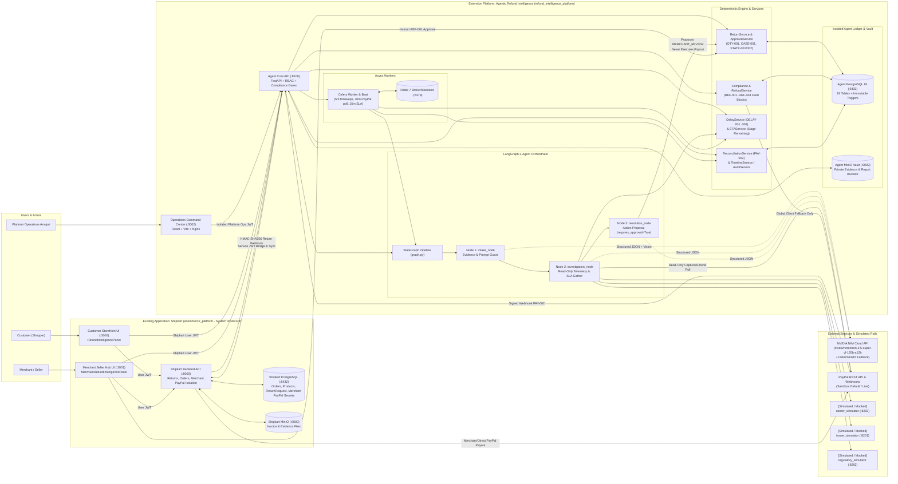
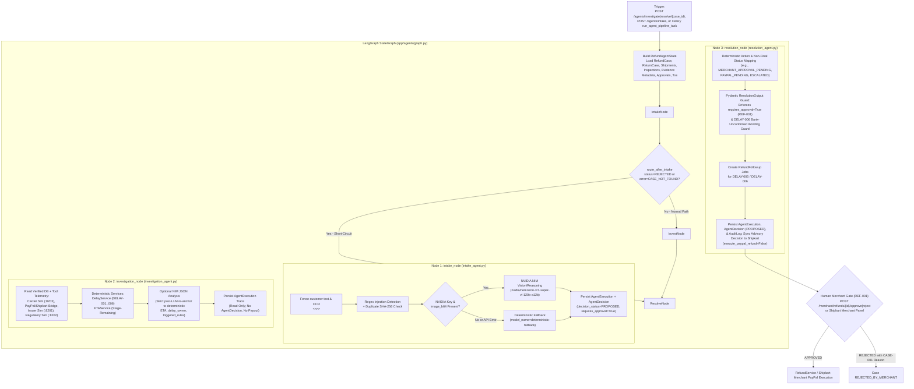
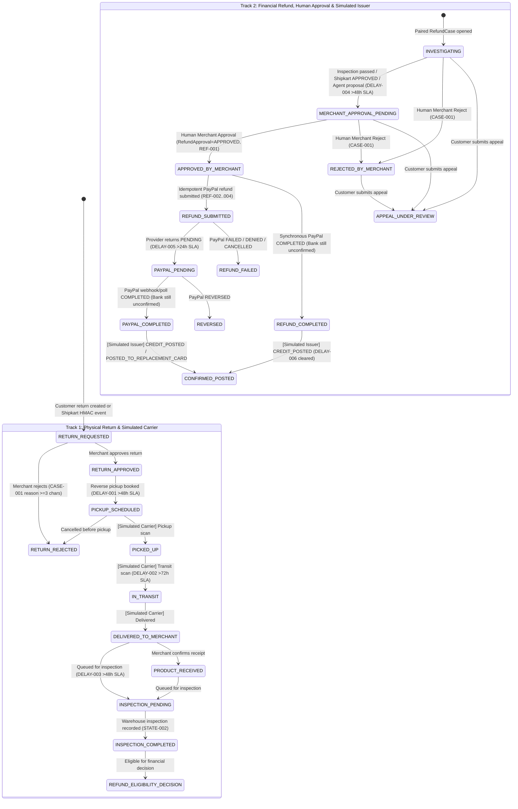
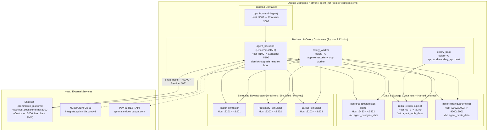

# Agentic Refund Intelligence & Resolution Platform

**Multi-agent refund investigation, deterministic delay-SLA attribution, stage-remaining ETA tracking, and policy-gated resolution extending an existing PayPal-enabled e-commerce platform (Shipkart).**

---

## Live Cloud Deployment & Reviewer Access

The live cloud deployment connects the **Refund Operations Console** (`refund_intelligence_platform`) with the companion **Shipkart** portals (`ecommerce_platform`) on Render.

### Public Live URLs (Render Free Tier)

- **Refund Operations Console (`refund-ops-26`, this platform):** https://refund-ops-26.onrender.com/
- **Shipkart Customer Storefront (`shipkart-customer-26`, companion):** https://shipkart-customer-26.onrender.com/
- **Shipkart Merchant Seller Hub (`shipkart-merchant-26`, companion):** https://shipkart-merchant-26.onrender.com/

> **Render Free Tier Cold-Start Note:** All services are hosted on the **Render Free Tier** and automatically spin down to sleep after inactivity (~15 min). On first load after idle, allow **30–60+ seconds** for the backend/frontend instances to wake up before retrying or refreshing.

### Reviewer Demo Accounts

- **Operations Console Account (`refund-ops-26`):** Email `ops@shipkart.com` / Password `ops@shipkart.com`
- **Customer Account (`shipkart-customer-26`):** Email `logith@gmail.com` / Password `logith@gmail.com`
- **Seller / Merchant Account (`shipkart-merchant-26`):** Email `nava@gmail.com` / Password `nava@gmail.com`

> **Account Registration Note:** Reviewers can also register new **Customer** and **Seller (Merchant)** accounts freely from the storefront / Seller Hub signup screens, whereas **Operations (`ops`) accounts are restricted/admin-managed** (public self-registration is disabled for `refund-ops-26`; use `ops@shipkart.com`).

---

## 1. Overview

The **Agentic Refund Intelligence & Resolution Platform** (`refund_intelligence_platform`) is a standalone containerized companion platform that extends the existing **Shipkart** (`ecommerce_platform`) marketplace application without replacing Shipkart's database, product catalog, order engine, or per-merchant PayPal credential isolation.

It introduces:
- **Dual-track return & refund visibility:** Separated tracking for the physical reverse-logistics lifecycle (`ReturnCase`, shipments, warehouse inspections) and the financial refund lifecycle (`RefundCase`, `RefundApproval`, `RefundTransaction`, `IssuerInquiry`).
- **Deterministic policy, SLA, and ETA engines:** Rule-based delay detection (`DELAY-001` through `DELAY-006`), stage-remaining ETA window computation (`ETAService`), and hard financial/tenant guards (`REF-001`..`REF-004`, `AUTH-001`/`AUTH-002`, `QTY-001`, `CASE-001`, `DATA-001`, `PAY-002`).
- **LangGraph 3-Agent pipeline:** `intake_node` -> `investigation_node` -> `resolution_node` backed by NVIDIA NIM (`nvidia/nemotron-3.5-super-vl-120b-a12b`) with a deterministic offline fallback (`model_name="deterministic-fallback"`). Agents can propose actions and summarize evidence, **never** bypass human Merchant approval (`REF-001`), and **never** disburse funds directly.
- **Dedicated Operations Command Center (`ops_frontend`):** A 9-page React + TypeScript console protected by isolated `platform_users` credentials to inspect cases, monitor connector health, audit agent traces, and drive three standalone `Simulated / mocked` FastAPI simulators (Issuer/Bank `:8201`, India/USA Regulatory `:8202`, Reverse Carrier `:8203`).

---

## 2. Problem Statement

E-commerce return and refund failures typically cross multiple independent failure domains:

1. **Physical vs. Financial Conflation:** Customers see a generic "Refund pending" state even when delays are caused by overdue carrier pickup, stalled return transit, uncompleted warehouse inspection, pending merchant approval, or post-PayPal card-issuer posting lag.
2. **False Settlement Claims:** Payment processors report `COMPLETED` once the refund leaves the merchant's PayPal ledger, yet cardholders often wait days for the issuing bank to post credit to their statement (`DELAY-006`).
3. **Manual Operational Triage:** Operations teams lack unified evidence verification, immutable audit logs, and accountable delay-owner attribution across carrier, merchant, payment gateway, and issuing bank stages.
4. **Unsafe AI Automation Risks:** Granting an LLM direct database mutation or refund payout capability introduces prompt-injection, duplicate-payout, and over-refund exposure.

---

## 3. Motivation & Real-World Context

In real-world marketplace operations (including cross-border and domestic flows across India and the United States):
- **Shipkart (`ecommerce_platform`) remains the system of record** for products, customer/merchant identities, orders, and merchant-specific encrypted PayPal API credentials.
- Customers and merchants expect intelligent refund tracking **inside** their existing storefront/seller workflows (`RefundIntelligencePanel.jsx` and `MerchantRefundIntelligencePanel.jsx`), while internal operations analysts require an isolated console (`ops_frontend` on port `:3002`) with no ability for customer or merchant tokens to access platform-wide operations endpoints.
- Any automated intelligence layer must clearly separate **deterministic rules**, **advisory LLM proposals**, **human financial sign-off**, and **simulated external rails**.

---

## 4. Goals and Non-Goals

### Goals
- Extend `ecommerce_platform` non-invasively via signed webhooks (`HMAC-SHA256`), short-lived Service JWTs, and nullable/indexed cross-platform integer foreign references (`shipkart_return_id`, `shipkart_order_id`, `shipkart_customer_id`, `shipkart_merchant_id`).
- Enforce hard deterministic guardrails before any refund payout (`REF-001` human approval, `REF-002` balance, `REF-003` idempotency, `REF-004` capture linkage).
- Distinguish PayPal `COMPLETED` from confirmed card-issuer bank posting (`DELAY-006`).
- Provide reproducible local Docker Compose orchestration and isolated unit/integration/agent test coverage (`71` pytest tests).
- Visibly label all downstream bank/issuer, carrier, and regulatory modules as `Simulated / mocked`.

### Non-Goals
- **Not a replacement** for Shipkart's catalog, checkout, cart, order management, or merchant PayPal vault.
- **No live issuing-bank or card-network control:** Cannot verify or accelerate real Visa/Mastercard/RuPay settlement.
- **No live carrier API integrations:** No real BlueDart, Delhivery, or FedEx webhooks/APIs.
- **Not legal or regulatory certification:** Regulatory rules in `:8202` are versioned software simulations and explicitly disclaim legal advice.
- **No autonomous LLM payout authority:** Agents never execute PayPal refunds or mutate `RefundApproval`.

---

## 5. Proposed Solution

The platform separates responsibilities into four strictly layered tiers:

1. **Extension Bridge Layer:** Shipkart posts return creation and status updates via `POST /api/v1/bridge/shipkart/return-event` (`X-Bridge-Signature` HMAC-SHA256). Agent Core queries Shipkart context and Merchant-Direct PayPal status via short-lived HS256 Service JWTs (`ShipkartBridgeClient`) and posts advisory recommendations (`execute_paypal_refund: false`).
2. **Deterministic Lifecycle & Compliance Core:** `ReturnService`, `ApprovalService`, `ComplianceService`, `RefundService`, `ReconciliationService`, `DelayService`, `ETAService`, `EvidenceService`, `TimelineService`, and `AuditService` enforce all state transitions, SLA evaluations, cryptographic file validation, and append-only immutability (`refund_approvals` and `audit_logs`).
3. **LangGraph 3-Agent Orchestrator:** Runs `intake_node -> investigation_node -> resolution_node` with untrusted customer text delimiter fencing (`<<<UNTRUSTED_CUSTOMER_TEXT>>>`), prompt-injection pattern checks, post-LLM deterministic re-anchoring, and schema-enforced `requires_approval=True` proposals.
4. **Simulated Downstream Rails + Ops Console:** Three independent FastAPI simulators (`issuer_simulator`, `regulatory_simulator`, `carrier_simulator`) enable repeatable testing of stall, mismatch, replacement-card, outage (`HTTP 503`), and cross-border rule scenarios via `ops_frontend`.

---

## 6. Verified Feature List with Implementation Status

Full evidence and code-vs-spec discrepancy notes are maintained in [docs/analysis/feature-status.md](file:///c:/Users/logit/Downloads/Paypal/refund_intelligence_platform/docs/analysis/feature-status.md).

| Feature | Status | Verified Implementation Summary |
| :--- | :--- | :--- |
| **Return tracking** | `Implemented — verified` *(Carrier `Simulated / mocked`)* | Return creation (`QTY-001`), state machine (`ALLOWED_RETURN_TRANSITIONS`), and warehouse inspections (`STATE-002`) verified in tests; carrier tracking scans use `carrier_simulator` (`:8203`). |
| **Refund tracking** | `Implemented — verified` | Dual physical/financial timelines, deterministic stage-remaining ETA snapshots, and `PAY-002` reconciliation verified in tests. |
| **Delay detection** | `Implemented — verified` | Deterministic `DELAY-001`..`DELAY-006` rules assign explicit owners (`MERCHANT`, `CARRIER`, `PAYPAL`, `ISSUER_OR_BANK`, `UNKNOWN`, `NONE`). |
| **Evidence collection** | `Implemented — verified` *(MinIO runtime `Implemented — not runtime-verified`)* | Magic-byte MIME checks (`JPEG`, `PNG`, `WEBP`, `PDF`), 10 MB limit, SHA-256 deduplication, and Pillow metadata extraction verified via `InMemoryObjectStorage`. |
| **Customer updates** | `Implemented — verified` *(pull-based REST; no email/SMS)* | Consolidated intelligence dossier, separated timelines, ETA, grounded chat (`DELAY-006` wording guard), and appeals via REST API + Shipkart Customer UI. |
| **Merchant approval** | `Implemented — verified` | Immutable `RefundApproval` (`APPROVED`/`REJECTED`) guarded by `AUTH-001`, `CASE-001`, and `REF-001` (`HTTP 403` without approval). |
| **Escalation** | `Implemented — verified` | Overdue SLA alerts, `RefundFollowup` polling queue, `APPEAL_UNDER_REVIEW`, and `ComplianceViolation` logs surfaced to Operations UI. |
| **PayPal integration** | `Partially implemented` / `Implemented — not runtime-verified` | HTTPX OAuth2 client, idempotent refunds, webhook verification + `PAY-002` dedup, and Merchant-Direct read bridge tested with mocks. Live Sandbox calls not run here; `/payments/paypal/refund` uses global `PayPalClient` while Shipkart executes Merchant-Direct payouts locally after recording `RefundApproval`. |
| **Simulated clock** | `Partially implemented` (`Simulated / mocked`) | `DelayService` (`as_of`), `ETAService` (`estimated_from`), and `regulatory_simulator` (`evaluation_date`) accept timestamps, and simulators step `+6h`/`+12h` on `/advance`; no global live virtual-clock API exists. |
| **India / US handling** | `Simulated / mocked` | Separate `original_currency` (`INR`) vs `paypal_currency` (`USD`) fields plus 4 heuristic IN/US rules (`:8202`) returning `UNKNOWN` when context is incomplete and disclaiming legal advice. |
| **LangGraph 3-Agent pipeline** | `Implemented — verified` *(Live NVIDIA NIM `Implemented — not runtime-verified`)* | `intake_node`, `investigation_node`, `resolution_node` verified in `tests/agents/test_three_agent_graph.py` with `deterministic-fallback`; automatic MinIO-to-`image_b64` loading for NIM Vision is `Partially implemented`. |

---

## 7. End-to-End Workflow

1. **Order & Return Origination (Shipkart -> Agent Bridge):** A customer requests a return in Shipkart (`ecommerce_platform`). Shipkart persists its `ReturnRequest` and sends a signed `HMAC-SHA256` webhook to `POST /api/v1/bridge/shipkart/return-event` (best-effort 2s relay), creating a paired `ReturnCase` (`RETURN_REQUESTED`), `RefundCase` (`INVESTIGATING`), and initial deterministic `RefundEtaEstimate`.
2. **Evidence Upload (Customer -> Agent Core -> MinIO):** The customer uploads receipts or damaged-item photos to `POST /api/v1/returns/{id}/evidence`. `EvidenceService` verifies magic bytes, size (`<= 10 MB`), SHA-256 hash, and image dimensions before writing privately to MinIO (`BUCKET_EVIDENCE`).
3. **3-Agent Investigation (`intake_node` -> `investigation_node` -> `resolution_node`):** Triggered via Celery `run_agent_pipeline_task` or `POST /api/v1/agents/investigate|resolve/{case_id}`:
   - `intake_node` fences untrusted text, flags injection attempts and duplicate SHA-256 hashes, and persists an `AgentExecution` + proposed `AgentDecision`.
   - `investigation_node` queries `CarrierSimulatorClient`, `PayPalClient` (or Shipkart's Merchant-Direct capture/refund bridge), `IssuerSimulatorClient`, and `RegulatorySimulatorClient`, then invokes deterministic `DelayService` and `ETAService`.
   - `resolution_node` maps a non-final recommended action/status, enforces `requires_approval=True` (`REF-001`) and `DELAY-006` wording rules, schedules `RefundFollowup` rows if needed, persists an `AgentDecision`, and relays advisory status back to Shipkart (`execute_paypal_refund: false`).
4. **Physical Return & Warehouse Inspection (Merchant / Simulated Carrier):** Reverse pickup & transit events come from `carrier_simulator` (`:8203`), synced to `ReturnShipment`. After `DELIVERED_TO_MERCHANT`, the merchant records warehouse inspection via `POST /api/v1/merchant/returns/{id}/inspect` (`STATE-002`).
5. **Mandatory Human Merchant Approval (`REF-001`):** Before any funds move, a merchant explicitly approves or rejects via `POST /api/v1/merchant/refunds/{id}/approve|reject`, inserting an immutable row in `refund_approvals`.
6. **Idempotent PayPal Refund Execution & Webhook Reconciliation (`PAY-002`):**
   - In **Merchant-Direct mode** (Shipkart Seller Hub), after recording `RefundApproval` in `agent_backend`, Shipkart calls PayPal using that merchant's isolated credentials and relays `RETURN_STATUS_UPDATED` (`REFUND_INITIATED` / `REFUNDED`) back via HMAC.
   - In **Platform PayPal mode**, `POST /api/v1/payments/paypal/refund` validates `REF-001`..`REF-004` under `SELECT FOR UPDATE` and calls PayPal `/v2/payments/captures/{id}/refund`.
   - `POST /api/v1/webhooks/paypal` and Celery's `reconcile_pending_paypal_refunds_task` reconcile asynchronous PayPal events into `PAYPAL_PENDING` or `PAYPAL_COMPLETED`.
7. **Post-PayPal Issuer Inquiry & Bank Posting Distinction (`DELAY-006`):** Even when PayPal reports `COMPLETED`, `RefundCase.status` does **not** become `CONFIRMED_POSTED` until issuer inquiry tracking (via `issuer_simulator`) reports `CREDIT_POSTED` / `POSTED_TO_REPLACEMENT_CARD`. Customer-facing explanations are sanitized to state clearly that bank posting is still pending when unconfirmed.

---

## 8. Combined System Architecture Diagram

High-level integration boundary showing `ecommerce_platform` (Shipkart, system of record), `refund_intelligence_platform` services, LangGraph 3-agent orchestrator, external providers, and clearly labeled `[Simulated / Mocked]` simulators. Editable source: [combined-system-architecture.mmd](file:///c:/Users/logit/Downloads/Paypal/refund_intelligence_platform/docs/architecture/combined-system-architecture.mmd).



---

## 9. Backend Architecture Diagram

Internal structure of `agent_backend/` showing routers, security middleware, domain services, integration wrappers, Celery workers, and PostgreSQL persistence. Editable source: [backend-architecture.mmd](file:///c:/Users/logit/Downloads/Paypal/refund_intelligence_platform/docs/architecture/backend-architecture.mmd).

```mermaid
flowchart TB
    subgraph Entrypoint["FastAPI App (app/main.py :8100)"]
        Middleware["CORS + X-Request-ID Middleware\n& RedactingFormatter"]
        ErrHandlers["Handlers: ComplianceViolationError,\nEvidenceValidationError, PayPalAPIError,\nSimulatorClientError, ShipkartBridgeError"]
    end

    subgraph Routers["API v1 Routers (app/api/v1/router.py)"]
        CustRoutes["Customer Routes\n/returns, /returns/{id}/evidence,\n/refunds/{id}/intelligence|timeline|eta|chat|appeals"]
        MerchRoutes["Merchant Routes\n/merchant/returns, /merchant/returns/{id}/inspect|transition,\n/merchant/refunds/{id}|investigation|approve|reject"]
        AgentRoutes["Agent Routes\n/agents/intake, /agents/investigate/{id},\n/agents/resolve/{id}, /agents/executions|decisions"]
        OpsRoutes["Operations Routes\n/operations/auth/*, /overview, /cases,\n/integrations/health, /eta, /compliance, /audit,\n/issuer-simulator/*, /carrier-simulator/*, /regulatory/*"]
        InternalRoutes["Internal, Bridge & Payment Routes\n/bridge/shipkart/return-event (HMAC),\n/payments/paypal/refund, /webhooks/paypal,\n/internal/eta|delays|reconciliation|followups|audit"]
    end

    subgraph Security["Security & RBAC (app/core/security.py)"]
        AuthDeps["get_current_actor, require_roles,\nverify_bridge_hmac, verify_shipkart_user_token,\nverify_service_jwt, scrypt platform_users auth"]
        Redact["Redaction Filter (DATA-001)\napp/core/logging_redact.py"]
    end

    subgraph Services["Domain Services (app/services/)"]
        ReturnSvc["ReturnService\nQTY-001 & STATE-001/002"]
        ApprovalSvc["ApprovalService\nImmutable REF-001 & CASE-001"]
        ComplianceSvc["ComplianceService\nREF-001..004 & AUTH-001..002"]
        RefundSvc["RefundService\nIdempotent Payout + SELECT FOR UPDATE"]
        ReconcileSvc["ReconciliationService\nPAY-002 Webhook & Polling"]
        DelaySvc["DelayService\nDELAY-001..006 SLA Rules"]
        EtaSvc["ETAService\nStage-Remaining Snapshot"]
        EvidenceSvc["EvidenceService\nMagic Bytes, Pillow, SHA-256"]
        TimelineSvc["TimelineService\nDual Physical/Financial Track"]
        AuditSvc["AuditService\nAppend-Only AuditLog"]
        SyncSvc["shipkart_sync_service\nDecision Relay (execute_paypal_refund=False)"]
    end

    subgraph Integrations["Integration Clients & Background Tasks"]
        ShipkartCli["ShipkartBridgeClient (HTTPX + Service JWT)"]
        PayPalCli["PayPalClient (OAuth2 + Captures/Refunds/Webhook Sig)"]
        MinioCli["AgentMinIOClient (Private Buckets + Presigned URLs)"]
        SimClis["Simulator Clients\nCarrier / Issuer / Regulatory (HTTPX)"]
        CeleryTasks["Celery Tasks (app/worker/tasks.py)\npipeline, followups, reconcile, detect_delays"]
    end

    subgraph Persistence["Persistence Layer (app/db/)"]
        Models["19 SQLAlchemy Models (models.py)\nPortable GUID / JSONB / NUMERIC(18,2)"]
        PG[("PostgreSQL 16 (:5433)\n+ Immutability Triggers")]
    end

    Middleware --> Routers
    Routers --> AuthDeps
    Routers --> Redact

    CustRoutes --> ReturnSvc
    CustRoutes --> EvidenceSvc
    CustRoutes --> TimelineSvc
    CustRoutes --> EtaSvc
    MerchRoutes --> ReturnSvc
    MerchRoutes --> ApprovalSvc
    InternalRoutes --> RefundSvc
    InternalRoutes --> ReconcileSvc
    InternalRoutes --> DelaySvc
    InternalRoutes --> EtaSvc
    AgentRoutes --> SyncSvc
    OpsRoutes --> DelaySvc
    OpsRoutes --> EtaSvc
    OpsRoutes --> SimClis

    RefundSvc --> ComplianceSvc
    RefundSvc --> PayPalCli
    RefundSvc --> AuditSvc
    ApprovalSvc --> ComplianceSvc
    ApprovalSvc --> AuditSvc
    ReturnSvc --> ComplianceSvc
    ReturnSvc --> AuditSvc
    EvidenceSvc --> MinioCli
    ReconcileSvc --> ShipkartCli
    ReconcileSvc --> TimelineSvc
    SyncSvc --> ShipkartCli

    CeleryTasks --> DelaySvc
    CeleryTasks --> EtaSvc
    CeleryTasks --> ReconcileSvc

    Services --> Models --> PG
```



---

## 10. Agent Architecture Diagram

Detailed control flow of the LangGraph `StateGraph` (`agent_backend/app/agents/graph.py`), deterministic fallback mechanism (`llm_factory.py`), post-LLM re-anchoring, and human approval gate (`REF-001`). Editable source: [agent-architecture.mmd](file:///c:/Users/logit/Downloads/Paypal/refund_intelligence_platform/docs/architecture/agent-architecture.mmd).



---

## 11. Refund Lifecycle Diagram

Separated state machines across physical returns (`ReturnService`), simulated reverse-logistics scans (`carrier_simulator`), financial refund cases (`ApprovalService`, `RefundService`, `ReconciliationService`), and simulated bank posting (`issuer_simulator`). Editable source: [refund-lifecycle.mmd](file:///c:/Users/logit/Downloads/Paypal/refund_intelligence_platform/docs/architecture/refund-lifecycle.mmd).



---

## 12. Sequence Diagram (Delayed Refund End-to-End)

End-to-end interaction trace from return ingestion and evidence upload through 3-agent investigation, human Merchant approval, PayPal disbursement (`PAY-002`), and simulated `DELAY-006` issuer lag resolution. Editable source: [refund-sequence.mmd](file:///c:/Users/logit/Downloads/Paypal/refund_intelligence_platform/docs/architecture/refund-sequence.mmd).

```mermaid
sequenceDiagram
    autonumber
    actor Customer
    actor Merchant
    participant Shipkart as Shipkart (ecommerce_platform :8000)
    participant API as Agent Backend (:8100)
    participant DB as Agent PostgreSQL (:5433)
    participant MinIO as Agent MinIO (:9002)
    participant Agents as LangGraph 3-Agent Pipeline
    participant CarrierSim as Carrier Simulator (:8203) [Simulated]
    participant PayPal as PayPal REST API / Webhooks
    participant IssuerSim as Issuer Simulator (:8201) [Simulated]

    Customer->>Shipkart: Request item return + reason/comments
    Shipkart->>API: POST /api/v1/bridge/shipkart/return-event (X-Bridge-Signature HMAC)
    API->>DB: Create ReturnCase + RefundCase (INVESTIGATING) + initial ETA
    API-->>Shipkart: 201 Created (return_case_id, refund_case_id)

    Customer->>API: POST /api/v1/returns/{id}/evidence (image/PDF + User JWT)
    API->>MinIO: Validate magic bytes & SHA-256, store privately
    API->>DB: Persist Evidence + RefundTimelineEvent

    API->>Agents: Trigger POST /api/v1/agents/resolve/{case_id} (or Celery async)
    Agents->>Agents: intake_node: fence untrusted text, check duplicates & injection
    Agents->>CarrierSim: investigation_node: query reverse shipment status [Simulated]
    Agents->>DB: Run deterministic DelayService (DELAY-001..006) & ETAService
    Agents->>DB: resolution_node: persist AgentDecision (PROPOSED, requires_approval=true)
    API->>Shipkart: POST /returns/{id}/agent-decision (Service JWT, execute_paypal_refund=false)

    Merchant->>API: POST /api/v1/merchant/refunds/{id}/approve (Human Gate REF-001)
    API->>DB: Insert immutable RefundApproval (APPROVED) + update ETA

    alt Merchant-Direct Bridge Mode (Shipkart Merchant Credentials)
        Merchant->>Shipkart: Execute approved refund with approval_reference
        Shipkart->>PayPal: POST /v2/payments/captures/{id}/refund (merchant creds)
        Shipkart->>API: HMAC RETURN_STATUS_UPDATED (REFUND_INITIATED / REFUNDED)
    else Global Platform PayPal Mode
        Merchant->>API: POST /api/v1/payments/paypal/refund (idempotency_key)
        API->>DB: Assert REF-001..REF-004 + SELECT FOR UPDATE
        API->>PayPal: POST /v2/payments/captures/{id}/refund
        API->>DB: Persist RefundTransaction (PENDING or COMPLETED)
    end

    PayPal-->>API: POST /api/v1/webhooks/paypal (PAYMENT.CAPTURE.REFUNDED)
    API->>DB: Deduplicate ProcessedWebhookEvent (PAY-002), set status=PAYPAL_COMPLETED

    Note over API,IssuerSim: DELAY-006 Guard: PayPal COMPLETED != Bank Credit Posted
    Agents->>IssuerSim: Open/poll simulated issuer inquiry [Simulated]
    IssuerSim-->>API: DELAYED_POSTING (credit_posted=false)
    API->>DB: Keep bank_confirmed=false; schedule RefundFollowup; sanitize customer wording
    IssuerSim-->>API: Advance to CREDIT_POSTED [Simulated]
    API->>DB: Transition RefundCase -> CONFIRMED_POSTED + ETA status=COMPLETED
```

---

## 13. Database ER / Data Model Diagram

All **19** SQLAlchemy tables defined in [models.py](file:///c:/Users/logit/Downloads/Paypal/refund_intelligence_platform/agent_backend/app/db/models.py) and migrations [0001_initial_schema.py](file:///c:/Users/logit/Downloads/Paypal/refund_intelligence_platform/agent_backend/alembic/versions/0001_initial_schema.py) + [0002_platform_users.py](file:///c:/Users/logit/Downloads/Paypal/refund_intelligence_platform/agent_backend/alembic/versions/0002_platform_users.py). Editable source: [database-er.mmd](file:///c:/Users/logit/Downloads/Paypal/refund_intelligence_platform/docs/architecture/database-er.mmd).

```mermaid
erDiagram
    return_cases ||--o{ return_case_items : "contains"
    return_cases ||--o{ return_shipments : "tracked_by"
    return_cases ||--o{ return_inspections : "inspected_in"
    return_cases ||--o{ refund_cases : "linked_to"
    return_cases ||--o{ evidence : "has_evidence"
    return_cases ||--o{ refund_timeline_events : "logs_physical"

    refund_cases ||--o{ refund_transactions : "settled_by"
    refund_cases ||--o{ refund_approvals : "governed_by_immutable"
    refund_cases ||--o{ evidence : "has_evidence"
    refund_cases ||--o{ refund_timeline_events : "logs_financial"
    refund_cases ||--o{ refund_eta_estimates : "estimated_by"
    refund_cases ||--o{ refund_followups : "polled_by"
    refund_cases ||--o{ issuer_inquiries : "investigated_at_issuer"
    refund_cases ||--o{ regulatory_evaluations : "checked_against"
    refund_cases ||--o{ compliance_violations : "flags"

    agent_executions ||--o{ agent_decisions : "proposes"

    return_cases {
        uuid id PK
        int shipkart_return_id UK
        int shipkart_order_id
        int shipkart_customer_id
        int shipkart_merchant_id
        string status
        string reason_code
    }
    return_case_items {
        uuid id PK
        uuid return_case_id FK
        int shipkart_order_item_id
        int quantity_requested
        int quantity_approved
        numeric refund_amount_requested
    }
    return_shipments {
        uuid id PK
        uuid return_case_id FK
        string carrier_name
        string tracking_number
        string status
        boolean is_simulated
    }
    return_inspections {
        uuid id PK
        uuid return_case_id FK
        int shipkart_inspector_id
        string inspection_status
        string condition_result
    }
    refund_cases {
        uuid id PK
        uuid return_case_id FK
        int shipkart_return_id
        int shipkart_order_id
        string status
        numeric requested_amount
        numeric approved_amount
        numeric captured_amount
        char original_currency
        char paypal_currency
        string paypal_capture_id
    }
    refund_transactions {
        uuid id PK
        uuid refund_case_id FK
        string paypal_capture_id
        string paypal_refund_id UK
        string idempotency_key UK
        numeric amount
        char currency
        string status
    }
    refund_approvals {
        uuid id PK "IMMUTABLE"
        uuid refund_case_id FK
        int shipkart_merchant_user_id
        string decision
        numeric approved_amount
        string approval_reference
    }
    evidence {
        uuid id PK
        uuid return_case_id FK
        uuid refund_case_id FK
        string storage_key
        string sha256_hash
        string verification_status
    }
    refund_timeline_events {
        uuid id PK
        uuid return_case_id FK
        uuid refund_case_id FK
        string event_type
        string source_type
        boolean verified
    }
    agent_executions {
        uuid id PK
        uuid case_id "RefundCase or ReturnCase UUID"
        string agent_name
        string model_name
        string status
    }
    agent_decisions {
        uuid id PK
        uuid execution_id FK
        string decision_type
        numeric confidence
        boolean requires_approval
        string decision_status
    }
    refund_eta_estimates {
        uuid id PK
        uuid refund_case_id FK
        string eta_status
        datetime earliest_at
        datetime latest_at
        boolean is_current
    }
    refund_followups {
        uuid id PK
        uuid refund_case_id FK
        string target_type
        string status
        int attempt_count
    }
    issuer_inquiries {
        uuid id PK
        uuid refund_case_id FK
        string provider_type
        string status
        boolean is_simulated
    }
    regulatory_evaluations {
        uuid id PK
        uuid refund_case_id FK
        char jurisdiction
        string evaluation_status
        string rule_version
        boolean is_simulated
    }
    compliance_violations {
        uuid id PK
        uuid refund_case_id FK
        string rule_code
        string severity
        string status
    }
    audit_logs {
        uuid id PK "IMMUTABLE"
        uuid actor_id
        int shipkart_actor_id
        string action
        string resource_type
        uuid resource_id
    }
    processed_webhook_events {
        uuid id PK
        string provider
        string provider_event_id
        string event_type
        string processing_status
    }
    platform_users {
        uuid id PK
        string email UK
        string password_hash
        string role
        boolean is_active
    }
```



---

## 14. Deployment Diagram

10-container local Docker Compose topology defined in [docker-compose.yml](file:///c:/Users/logit/Downloads/Paypal/refund_intelligence_platform/docker-compose.yml) on bridge network `agent_net`, alongside three persistent volumes and `host.docker.internal:8000` Shipkart connectivity. Editable source: [deployment.mmd](file:///c:/Users/logit/Downloads/Paypal/refund_intelligence_platform/docs/architecture/deployment.mmd).



> **Render Blueprint Note ([render.yaml](file:///c:/Users/logit/Downloads/Paypal/refund_intelligence_platform/render.yaml)):** A Render free-tier Blueprint deploys `refund-issuer-sim-26`, `refund-regulatory-sim-26`, `refund-carrier-sim-26`, `refund-agent-api-26`, and `refund-ops-26`, setting `DB_SCHEMA="refund_intelligence"` (so it can safely share `shipkart-db` on Render's 1-free-DB limit without schema/table collisions), `CELERY_TASK_ALWAYS_EAGER="true"`, and `REDIS_URL=""`.

---

## 15. Agent Responsibilities and Decision Boundaries

The platform uses **3 LangGraph nodes** orchestrated via [graph.py](file:///c:/Users/logit/Downloads/Paypal/refund_intelligence_platform/agent_backend/app/agents/graph.py), plus a grounded customer chat helper (`answer_customer_chat_question` in the same module). Every non-LLM rule engine (`DelayService`, `ETAService`, `ComplianceService`, `RefundService`) is standard deterministic Python code—never represented as an AI agent.

| Agent / Component | Verified Responsibility | Inputs | Tools / Data Access | Output | Can Change State? | Approval Boundary |
| :--- | :--- | :--- | :--- | :--- | :--- | :--- |
| **`intake_node`** (`app/agents/intake_agent.py`) | Fences untrusted customer text/OCR (`<<<UNTRUSTED_CUSTOMER_TEXT>>>`), flags regex prompt-injection patterns, detects duplicate evidence SHA-256 hashes, optionally calls NIM Vision if `image_b64` & key exist | `customer_message`, `untrusted_ocr_texts`, `evidence_items` | Read-only case/evidence context; optional `ChatNVIDIA` (`NVIDIA_VISION_MODEL` / `NVIDIA_REASONING_MODEL`) | `IntakeOutput` JSON (`case_classification`, `missing_evidence`, `duplicate_evidence_ids`, `injection_risk_detected`, `requires_approval=True`) | Writes `AgentExecution` and `AgentDecision (PROPOSED)` only | **No financial authority.** Proposes classification/missing docs; human Merchant decides return/refund. |
| **`investigation_node`** (`app/agents/investigation_agent.py`) | Gathers live & simulated case evidence across logistics, PayPal/Shipkart bridge, issuer posting, and IN/US regulatory rules; invokes `DelayService` & `ETAService`; re-anchors LLM output to deterministic SLA/ETA facts | `RefundAgentState`, DB rows, `clients` dict | `CarrierSimulatorClient`, `PayPalClient` / `ShipkartBridgeClient` (read-only), `IssuerSimulatorClient` (auto-opens simulated inquiry if PayPal `COMPLETED`), `RegulatorySimulatorClient`, `DelayService`, `ETAService` | `InvestigationOutput` JSON (`delay_owner`, `triggered_rules`, `eta_status`, `evidence_findings`, `requires_approval=True`) | Writes `AgentExecution` trace only (and optional `IssuerInquiry` if created via simulator) | **Read-only investigation.** Cannot approve returns, alter capture balances, or initiate PayPal payouts. |
| **`resolution_node`** (`app/agents/resolution_agent.py`) | Deterministically selects recommended non-final action/status, generates customer & merchant explanations (with `DELAY-006` wording guard forbidding unconfirmed "bank posted" claims), schedules `RefundFollowup` polls | `RefundAgentState`, `investigation_result` | `RefundCase`, `DelayService`, `RefundFollowup` insert, `AuditService`, optional `ChatNVIDIA`, outbound `sync_decision_to_shipkart` (`execute_paypal_refund=False`) | `ResolutionOutput` JSON (`recommended_action`, `recommended_status`, `requires_approval=True`, `customer_explanation`, `merchant_brief`) | Updates non-final `RefundCase.status` (never `APPROVED_BY_MERCHANT` / `CONFIRMED_POSTED` / `REFUND_COMPLETED`), persists `AgentDecision (PROPOSED)` & `AuditLog` | **Strict `REF-001` boundary:** Pydantic `model_validator` raises if `requires_approval != True`. PayPal payout requires human `RefundApproval(APPROVED)`. |
| **`DelayService`, `ETAService`, `ComplianceService`, `RefundService`** *(Deterministic Python Services)* | Enforces `DELAY-001`..`006`, stage-remaining ETA windows, `REF-001`..`004`, `AUTH-001`/`002`, `QTY-001`, `CASE-001`, and idempotent payout execution | SQLAlchemy models & request params | Direct PostgreSQL session (`SELECT FOR UPDATE` on payout), `PayPalClient` | Deterministic dicts, `RefundEtaEstimate`, `RefundTransaction`, `ComplianceViolation` | Yes — authoritative DB & PayPal mutations | Executes PayPal refund **only** after verifying human `RefundApproval(decision='APPROVED')`. |

### Separation of Authority
- **LLM Reasoning / Language Generation:** Classifies intake text, summarizes evidence timelines, and drafts human-readable briefs (`nvidia/nemotron-3.5-super-vl-120b-a12b`, or static structured templates when `NVIDIA_API_KEY` is blank/unavailable).
- **Deterministic Policy & Calculation:** `ComplianceService`, `DelayService`, `ETAService`, and post-LLM re-anchoring unconditionally override or gate any numeric, SLA, status, or safety-critical field.
- **Human Approval & Financial Side Effects:** Only an authenticated Merchant (or authorized operator via `POST /api/v1/merchant/refunds/{id}/approve`) creates an immutable `RefundApproval` enabling disbursement.

---

## 16. Technology Stack (Verified Versions)

| Layer | Technology | Verified Source / Constraint |
| :--- | :--- | :--- |
| **Backend Runtime** | Python `3.12` (`python:3.12-slim`; verified locally `Python 3.12.8`) | [agent_backend/Dockerfile](file:///c:/Users/logit/Downloads/Paypal/refund_intelligence_platform/agent_backend/Dockerfile) |
| **Backend Framework** | FastAPI `>=0.115.0`, Uvicorn `>=0.30.0`, Pydantic `>=2.8.0`, Pydantic Settings `>=2.4.0` | [agent_backend/requirements.txt](file:///c:/Users/logit/Downloads/Paypal/refund_intelligence_platform/agent_backend/requirements.txt) |
| **ORM & Migrations** | SQLAlchemy `>=2.0.30`, Alembic `>=1.13.0`, `psycopg[binary]>=3.2.0` | [agent_backend/requirements.txt](file:///c:/Users/logit/Downloads/Paypal/refund_intelligence_platform/agent_backend/requirements.txt) |
| **Database** | PostgreSQL `16` (`postgres:16-alpine`) | [docker-compose.yml](file:///c:/Users/logit/Downloads/Paypal/refund_intelligence_platform/docker-compose.yml) |
| **Agents & LLM** | LangGraph `>=0.2.0`, `langchain-core>=0.3.0`, `langchain-nvidia-ai-endpoints>=0.3.0` (`nvidia/nemotron-3.5-super-vl-120b-a12b`) | [agent_backend/requirements.txt](file:///c:/Users/logit/Downloads/Paypal/refund_intelligence_platform/agent_backend/requirements.txt), [config.py](file:///c:/Users/logit/Downloads/Paypal/refund_intelligence_platform/agent_backend/app/core/config.py) |
| **Task Queue & Cache** | Celery `>=5.4.0`, Redis `7` (`redis:7-alpine`), `redis>=5.0.0` | [docker-compose.yml](file:///c:/Users/logit/Downloads/Paypal/refund_intelligence_platform/docker-compose.yml), [celery_app.py](file:///c:/Users/logit/Downloads/Paypal/refund_intelligence_platform/agent_backend/app/worker/celery_app.py) |
| **Object Storage & Media** | MinIO (`cgr.dev/chainguard/minio:latest`), `minio>=7.2.7`, `pillow>=10.4.0` | [docker-compose.yml](file:///c:/Users/logit/Downloads/Paypal/refund_intelligence_platform/docker-compose.yml), [agent_backend/requirements.txt](file:///c:/Users/logit/Downloads/Paypal/refund_intelligence_platform/agent_backend/requirements.txt) |
| **Security & HTTP** | `pyjwt[crypto]>=2.9.0`, `cryptography>=43.0.0`, `httpx>=0.27.0` | [agent_backend/requirements.txt](file:///c:/Users/logit/Downloads/Paypal/refund_intelligence_platform/agent_backend/requirements.txt) |
| **Operations Frontend** | Node `20-alpine` (Docker build; verified locally `Node 24.15.0`), React `^18.3.1`, TypeScript `^5.6.3`, Vite `^5.4.11`, Tailwind CSS `^3.4.15`, React Router `^6.28.0`, Lucide React `^0.460.0`, Nginx (`nginx:alpine`) | [ops_frontend/package.json](file:///c:/Users/logit/Downloads/Paypal/refund_intelligence_platform/ops_frontend/package.json), [ops_frontend/Dockerfile](file:///c:/Users/logit/Downloads/Paypal/refund_intelligence_platform/ops_frontend/Dockerfile) |
| **Simulators (3 apps)** | FastAPI `>=0.115.0,<1.0.0`, Uvicorn `>=0.32.0,<1.0.0`, Pydantic `>=2.9.0,<3.0.0` | `simulators/*/requirements.txt` |
| **Testing** | `pytest>=8.0.0` (SQLite in-memory + FastAPI `TestClient` + mocked HTTPX/MinIO) | [agent_backend/requirements.txt](file:///c:/Users/logit/Downloads/Paypal/refund_intelligence_platform/agent_backend/requirements.txt), `agent_backend/tests/` |

---

## 17. Repository Structure

```text
refund_intelligence_platform/
├── .env.example                       # Root environment template for Docker Compose & local services
├── docker-compose.yml                 # 10-service Compose stack (PG16, Redis7, MinIO, 3 simulators, API, Celery worker/beat, Ops UI)
├── render.yaml                        # Render Blueprint deployment spec (eager Celery mode, PostgreSQL, 3 simulators, Ops UI)
├── agent_backend/
│   ├── Dockerfile                     # Python 3.12-slim image running alembic upgrade head + uvicorn :8100
│   ├── alembic.ini                    # Alembic config targeting localhost:5433 by default
│   ├── requirements.txt               # Backend Python dependencies
│   ├── .env.example                   # Non-Docker local agent_backend env template
│   ├── alembic/versions/              # Migrations 0001_initial_schema.py (18 tables + PG triggers) & 0002_platform_users.py
│   ├── app/
│   │   ├── main.py                    # FastAPI app factory, CORS, X-Request-ID, operator bootstrap, /health
│   │   ├── core/                      # config.py, security.py (JWT/HMAC/scrypt), logging_redact.py (DATA-001)
│   │   ├── db/                        # base.py, session.py, types.py (GUID/JSONB/INET), models.py (19 models)
│   │   ├── api/v1/                    # Routers: customer/, merchant/, agents/, operations/, internal_and_webhooks.py
│   │   ├── agents/                    # LangGraph graph.py, state.py, llm_factory.py, intake/investigation/resolution agents
│   │   ├── schemas/                   # Strict Pydantic agent I/O schemas (agent_io.py)
│   │   ├── services/                  # Deterministic lifecycle, compliance, delay, ETA, evidence, PayPal reconciliation, sync
│   │   ├── integrations/              # paypal_client.py, shipkart_client.py, minio_client.py, simulators.py
│   │   └── worker/                    # celery_app.py (5m/10m/15m Beat schedule) & tasks.py
│   └── tests/                         # 71 tests across unit/, integration/, agents/
├── ops_frontend/
│   ├── Dockerfile                     # Multi-stage Node 20 build -> Nginx :3002
│   ├── nginx.conf.template            # SPA fallback routing on ${PORT}
│   ├── package.json                   # React 18 + Vite 5 + TypeScript 5.6 + Tailwind 3
│   └── src/
│       ├── App.tsx                    # Routes across 9 Ops Console pages + isolated PlatformLoginScreen
│       ├── api/client.ts              # Fetch client injecting isolated platform operator JWT
│       ├── components/                # OpsLayout.tsx, PlatformLoginScreen.tsx, SimulatedBadge.tsx, StatusPill.tsx
│       └── pages/                     # Dashboard, Cases, Agents, Integrations, IssuerSimulator, Regulatory, Eta, Compliance, Audit
├── simulators/
│   ├── issuer_simulator/              # Simulated card-issuer posting inquiry API (:8201, 8 scenarios)
│   ├── regulatory_simulator/          # Simulated IN/US rules engine (:8202, 4 versioned rules + disclaimer)
│   └── carrier_simulator/             # Simulated reverse-logistics carrier tracking API (:8203, 5 scenarios)
└── docs/
    ├── architecture/                  # Editable Mermaid .mmd source files (7 diagrams)
    ├── analysis/                      # feature-status.md, constraints-assumptions-limitations.md, api-inventory.md
    ├── plans/                         # Implementation planning records
    ├── specs/                         # Initial architecture design spec
    └── sdd-ledger.md                  # Engineering task ledger
```

---

## 18. API Reference (Actual Routes Summary)

The complete endpoint-by-endpoint inventory—including request schemas, query parameters, status codes, database mutations, and all **21** simulator endpoints across `:8201`–`:8203`—is documented in [docs/analysis/api-inventory.md](file:///c:/Users/logit/Downloads/Paypal/refund_intelligence_platform/docs/analysis/api-inventory.md).

Summary of the **50** registered routes on `agent_backend` (`:8100`):
- **Health (`app/main.py`):** `GET /health`
- **Customer (`customer/`):** `POST|GET /api/v1/returns`, `GET /api/v1/returns/{return_id}`, `POST /api/v1/returns/{return_id}/evidence`, `GET /api/v1/refunds`, `GET /api/v1/refunds/{refund_id}`, `GET /api/v1/refunds/{refund_id}/intelligence`, `GET /api/v1/refunds/{refund_id}/timeline`, `GET /api/v1/refunds/{refund_id}/eta`, `POST /api/v1/refunds/{refund_id}/chat`, `POST /api/v1/refunds/{refund_id}/appeals`
- **Merchant (`merchant/`):** `GET /api/v1/merchant/returns`, `GET /api/v1/merchant/returns/{return_id}`, `POST /api/v1/merchant/returns/{return_id}/inspect`, `POST /api/v1/merchant/returns/{return_id}/transition`, `GET /api/v1/merchant/refunds`, `GET /api/v1/merchant/refunds/{refund_id}`, `GET /api/v1/merchant/refunds/{refund_id}/investigation`, `POST /api/v1/merchant/refunds/{refund_id}/approve`, `POST /api/v1/merchant/refunds/{refund_id}/reject`
- **LangGraph Agents (`agents/`):** `POST /api/v1/agents/intake`, `POST /api/v1/agents/investigate/{case_id}`, `POST /api/v1/agents/resolve/{case_id}`, `GET /api/v1/agents/executions/{execution_id}`, `GET /api/v1/agents/decisions/{case_id}`
- **Operations Console & Simulators (`operations/`):** `/api/v1/operations/auth/{status,setup,login,me,demo-session}`, `/overview`, `/cases`, `/cases/{refund_case_id}`, `/agents/executions`, `/integrations/health`, `/eta`, `/issuer-simulator/{inquiries,scenarios/{inquiry_id}/trigger}`, `/carrier-simulator/{shipments,shipments/{tracking_number}/scenario}`, `/regulatory`, `/regulatory/rules`, `/regulatory/evaluate`, `/compliance`, `/audit`
- **Payments, Webhooks, Internal & Bridge (`internal_and_webhooks.py`):** `POST /api/v1/payments/paypal/refund`, `POST /api/v1/webhooks/paypal`, `POST /api/v1/bridge/shipkart/return-event`, `POST /api/v1/internal/{eta/recalculate,eta/calculate,delays/detect,reconciliation/run,followups/schedule,followups/run}`, `GET /api/v1/internal/audit/events`

---

## 19. Database Model and Relationships

PostgreSQL 16 database `refund_intelligence` (`agent_backend/app/db/models.py`, Alembic head `0002_platform_users`) stores **19 tables** using UUID primary keys, JSONB payloads, `NUMERIC(18, 2)` monetary amounts (no `Float`), and portable SQLite test variants (`app/db/types.py`):

| Group | Tables | Key Cross-References & Controls |
| :--- | :--- | :--- |
| **Physical Return** | `return_cases`, `return_case_items`, `return_shipments`, `return_inspections` | `shipkart_return_id` (unique), `shipkart_order_id`, `shipkart_customer_id`, `shipkart_merchant_id`, `shipkart_order_item_id`; `return_shipments.is_simulated` flags simulator rows |
| **Financial Refund & Immutability** | `refund_cases`, `refund_transactions`, `refund_approvals` *(immutable)* | Tracks `original_currency` (`INR`) separately from `paypal_currency` (`USD`); unique `idempotency_key` & `paypal_refund_id`; `refund_approvals` protected against `UPDATE`/`DELETE` via ORM hooks and PG trigger `trg_refund_approvals_immutable` |
| **Evidence & Dual Timeline** | `evidence`, `refund_timeline_events` | Evidence links `storage_key` (private MinIO object) and `sha256_hash`; timelines distinguish physical return vs. financial refund events |
| **AI Traceability** | `agent_executions`, `agent_decisions` | Stores prompt/model (`nvidia/nemotron-3.5-super-vl-120b-a12b` or `deterministic-fallback`), latency, confidence (`NUMERIC(5,4)`), `requires_approval`, and `PROPOSED` recommendations |
| **Monitoring & Simulators** | `refund_eta_estimates`, `refund_followups`, `issuer_inquiries`, `regulatory_evaluations` | Snapshot history (`is_current`), followup polling attempts, `is_simulated=True` simulator records |
| **Governance & Ops Auth** | `compliance_violations`, `audit_logs` *(immutable)*, `processed_webhook_events`, `platform_users` | `audit_logs` protected by PG trigger `trg_audit_logs_immutable`; `processed_webhook_events` enforces unique `(provider, provider_event_id)` (`PAY-002`); `platform_users` stores salted `scrypt` hashes isolated from Shipkart |

---

## 20. Payment-Provider Integration and Limitations

- **Client & Base URL (`app/integrations/paypal_client.py`, `app/core/config.py`):** Synchronous `httpx.Client` OAuth2 (`client_credentials`) integration targeting `https://api-m.sandbox.paypal.com` when `PAYPAL_ENV=SANDBOX` (default) or `https://api-m.paypal.com` when `PAYPAL_ENV=LIVE`.
- **Two Disbursement Topologies:**
  1. **Merchant-Direct Bridge (Default with Shipkart):** `agent_backend` leaves `PAYPAL_CLIENT_ID`/`PAYPAL_CLIENT_SECRET` blank and reads PayPal capture/refund status through `ShipkartBridgeClient` (`GET /api/v1/orders/{id}/paypal-capture-status` and `GET /api/v1/returns/{id}/paypal-refund-status`) without storing merchant PayPal credentials. The merchant approves in `agent_backend` (`RefundApproval`) and executes payout in Shipkart's Seller Hub (`POST /api/v1/returns/{id}/execute-approved-refund`), which syncs back via HMAC.
  2. **Platform PayPal Endpoint (`POST /api/v1/payments/paypal/refund`):** Uses `agent_backend`'s global `PayPalClient` credentials (`PAYPAL_CLIENT_ID`/`SECRET`), acquires `SELECT FOR UPDATE`, asserts `REF-001`..`REF-004`, sends `PayPal-Request-Id: <idempotency_key>`, and parses `COMPLETED` vs `PENDING`.
- **Webhook Verification & Idempotency (`POST /api/v1/webhooks/paypal`):** Calls PayPal `POST /v1/notifications/verify-webhook-signature` and deduplicates `(provider="paypal", provider_event_id)` in `processed_webhook_events` (`PAY-002`). **Important limitation:** In `development`/`dev`/`local`/`test`, if `PAYPAL_WEBHOOK_ID` is empty, cryptographic signature verification is skipped.
- **PayPal `COMPLETED` != Bank Posting:** Neither `RefundService` nor `ReconciliationService` ever marks a case `CONFIRMED_POSTED` from PayPal alone (`PAYPAL_COMPLETED` / `REFUND_COMPLETED` only). Bank posting status is exclusively modeled via `IssuerInquiry` (currently `Simulated / mocked`).

---

## 21. Configuration & Environment Variables

Copy `.env.example` to `.env` before running Docker Compose or local processes. **Never commit secrets or real keys.**

| Variable | Required? | Used By | Purpose | Safe Example |
| :--- | :--- | :--- | :--- | :--- |
| `ENVIRONMENT` | Optional (`development`) | `agent_backend` | Controls demo-session gating and dev webhook checks (`development` vs `production`) | `development` |
| `DATABASE_URL` | Required | `agent_backend`, `celery_*`, `alembic` | PostgreSQL 16 SQLAlchemy connection URI | `postgresql+psycopg://refund_agent:<password>@localhost:5433/refund_intelligence` |
| `POSTGRES_DB` / `POSTGRES_USER` / `POSTGRES_PASSWORD` | Required (Compose) | `postgres`, `agent_backend`, `celery_*` | Docker PostgreSQL initialization credentials | `refund_intelligence` / `refund_agent` / `<db_password>` |
| `REDIS_URL`, `CELERY_BROKER_URL`, `CELERY_RESULT_BACKEND` | Required for async workers | `agent_backend`, `celery_worker`, `celery_beat` | Redis broker/result backend URLs (blank in eager/Render free tier) | `redis://localhost:6379/0` |
| `CELERY_TASK_ALWAYS_EAGER` | Optional (`false`) | `celery_app` | Set `true` when running without a Redis broker/Celery worker | `false` |
| `MINIO_ENDPOINT`, `MINIO_PUBLIC_URL`, `MINIO_SECURE` | Required for evidence uploads | `agent_backend`, `minio` | S3-compatible MinIO host/port (`localhost:9002` local, `minio:9000` Docker) | `localhost:9002` |
| `MINIO_ACCESS_KEY`, `MINIO_SECRET_KEY` | Required for MinIO | `agent_backend`, `minio` | Private MinIO object storage credentials | `<minio_access_key>` |
| `BUCKET_EVIDENCE`, `BUCKET_REPORTS` | Optional | `agent_backend` | Private MinIO bucket names | `refund-evidence`, `refund-reports` |
| `SHIPKART_API_URL` / `SHIPKART_DOCKER_API_URL` | Required for Shipkart sync | `agent_backend`, `celery_worker` | Shipkart base URL (`http://localhost:8000` local, `http://host.docker.internal:8000` Docker) | `http://localhost:8000` |
| `BRIDGE_SHARED_SECRET` | Required for Shipkart bridge | `agent_backend`, Shipkart | Shared secret verifying inbound `X-Bridge-Signature` HMAC-SHA256 | `<bridge_hmac_secret>` |
| `SERVICE_JWT_SECRET` | Required for Shipkart bridge | `agent_backend` | HS256 secret signing outbound service JWTs (`iss=refund-intelligence-platform`) | `<service_jwt_secret>` |
| `JWT_SECRET_KEY` | Required for Auth | `agent_backend` | HS256 verification key for Shipkart customer/merchant JWTs & Ops operator JWTs | `<jwt_secret_key>` |
| `PLATFORM_ADMIN_EMAIL`, `PLATFORM_ADMIN_PASSWORD`, `PLATFORM_JWT_EXPIRE_MINUTES` | Optional | `agent_backend` | Optional startup seed for first `PlatformUser` (`>=8` char password) & Ops JWT TTL (`720` min) | `ops@example.com` / `<min_8_chars>` |
| `NVIDIA_API_KEY` | Optional | `agent_backend` (`llm_factory`) | NVIDIA NIM API key (`nvapi-...`); leave blank for deterministic fallback mode | `` |
| `NVIDIA_BASE_URL`, `NVIDIA_REASONING_MODEL`, `NVIDIA_VISION_MODEL` | Optional | `agent_backend` | NVIDIA NIM OpenAI-compatible URL & model ID | `https://integrate.api.nvidia.com/v1`, `nvidia/nemotron-3.5-super-vl-120b-a12b` |
| `PAYPAL_ENV`, `PAYPAL_CLIENT_ID`, `PAYPAL_CLIENT_SECRET`, `PAYPAL_WEBHOOK_ID` | Optional (if Merchant-Direct) | `agent_backend` | PayPal environment (`SANDBOX` or `LIVE`) and global platform PayPal credentials | `SANDBOX` / `` |
| `ISSUER_SIMULATOR_URL`, `REGULATORY_SIMULATOR_URL`, `CARRIER_SIMULATOR_URL` | Required | `agent_backend`, `celery_worker` | Simulator base URLs (`:8201`, `:8202`, `:8203` local; service DNS in Docker) | `http://localhost:8201` .. `:8203` |
| `AGENT_API_PORT`, `OPS_FRONTEND_PORT`, `VITE_AGENT_API_URL`, `CORS_ORIGINS` | Optional | Compose / Vite / FastAPI | Exposed ports (`8100`, `3002`), frontend API target, allowed browser origins | `8100`, `3002`, `http://localhost:8100` |

---

## 22. Installation and Local Setup

### Prerequisites
- **Docker & Docker Compose** (recommended for all 10 services)
- Or for bare-metal development: **Python 3.12+**, **Node.js 20+**, PostgreSQL 16, Redis 7, and MinIO.

### Option A: Docker Compose Setup (Full Stack)

```bash
cd refund_intelligence_platform
cp .env.example .env
# Populate BRIDGE_SHARED_SECRET, SERVICE_JWT_SECRET, and JWT_SECRET_KEY to match ecommerce_platform/.env
```

### Option B: Local Non-Docker Setup

```bash
# 1. Backend & Simulators Python environment
cd refund_intelligence_platform/agent_backend
python -m venv .venv
# Linux/macOS: source .venv/bin/activate
# Windows PowerShell: .venv\Scripts\Activate.ps1
pip install -r requirements.txt
cp .env.example .env

# 2. Apply Alembic migrations (requires PostgreSQL running on localhost:5433)
alembic upgrade head

# 3. Install Ops Frontend dependencies
cd ../ops_frontend
npm install
```

---

## 23. Run Instructions

### Start Everything with Docker Compose

```bash
cd refund_intelligence_platform
docker compose up --build
```

Exposed local endpoints:
- **Operations Command Center (`ops_frontend`):** `http://localhost:3002`
- **Agent Core API & Swagger (`agent_backend`):** `http://localhost:8100` (`GET /health`, `/docs`)
- **Simulated Issuer Service (`issuer_simulator`):** `http://localhost:8201/health`
- **Simulated Regulatory Service (`regulatory_simulator`):** `http://localhost:8202/health`
- **Simulated Carrier Service (`carrier_simulator`):** `http://localhost:8203/health`
- **PostgreSQL 16 / Redis 7 / MinIO:** `localhost:5433`, `localhost:6379`, `localhost:9002` (API) / `localhost:9003` (Console)

### Start Services Manually (Non-Docker)

Run each simulator and worker in separate terminals from `refund_intelligence_platform/`:

```bash
# Terminal 1-3: Simulators [Simulated / mocked]
uvicorn app.main:app --app-dir simulators/issuer_simulator --host 0.0.0.0 --port 8201
uvicorn app.main:app --app-dir simulators/regulatory_simulator --host 0.0.0.0 --port 8202
uvicorn app.main:app --app-dir simulators/carrier_simulator --host 0.0.0.0 --port 8203

# Terminal 4: Agent Core API (run alembic upgrade head first)
cd agent_backend && uvicorn app.main:app --host 0.0.0.0 --port 8100 --reload

# Terminal 5-6: Celery Worker & Beat
cd agent_backend && celery -A app.worker.celery_app worker --loglevel=info
cd agent_backend && celery -A app.worker.celery_app beat --loglevel=info

# Terminal 7: Ops Frontend dev server (:3002 via Vite proxy/API URL)
cd ops_frontend && npm run dev -- --host 0.0.0.0 --port 3002
```

First-time Operations login: open `http://localhost:3002` to complete initial operator setup (`POST /api/v1/operations/auth/setup`), or configure `PLATFORM_ADMIN_EMAIL` / `PLATFORM_ADMIN_PASSWORD` in `.env` before startup.

---

## 24. Test, Lint, and Build Instructions

### Actually Executed Verification Results (This Codebase Snapshot)

| Check | Working Directory | Exact Command | Outcome | Notes / Scope |
| :--- | :--- | :--- | :--- | :--- |
| **Backend Unit, Integration & Agent Tests** | `refund_intelligence_platform/agent_backend` | `python -m pytest -q` | **Passed (`71 passed in 14.89s`, exit `0`)** | Runs against in-memory SQLite, FastAPI `TestClient`, `InMemoryObjectStorage`, and mocked PayPal/Shipkart/simulator HTTPX transports; does **not** exercise live Docker PostgreSQL triggers, Redis Beat, MinIO server, or live NVIDIA NIM/PayPal calls. |
| **Ops Frontend TypeScript Check** | `refund_intelligence_platform/ops_frontend` | `npx tsc --noEmit` | **Passed (exit `0`)** | Verified strict TypeScript compilation across all 9 pages, API client, and components. |
| **Ops Frontend Production Bundle** | `refund_intelligence_platform/ops_frontend` | `npm run build` | **Not run** | Runs `tsc --noEmit && vite build` per `package.json`; not executed separately beyond `npx tsc --noEmit`. |
| **Live Multi-Container Compose / Shipkart E2E** | `refund_intelligence_platform` | `docker compose up --build` | **Not run** | Live container-to-container integration not executed in this verification pass. |

> **Python Path Note:** On Windows/local Python without editable package installation, run `python -m pytest -q` (rather than bare `pytest -q`) from `agent_backend/` so `app` is on `sys.path`.

---

## 25. Security and Privacy Controls

- **Isolated Authentication Planes (`app/core/security.py`):**
  - Customer (`AUTH-002`) and Merchant (`AUTH-001`) APIs accept HS256 Shipkart User JWTs signed with `JWT_SECRET_KEY`.
  - Operations endpoints require isolated `platform_users` credentials (salted `scrypt`, `N=16384, r=8, p=1`) or `operations`/`admin`/`service` roles—Shipkart customer/merchant tokens receive `HTTP 403`.
  - Service-to-service calls use short-lived HS256 Service JWTs (`SERVICE_JWT_SECRET`, `iss="refund-intelligence-platform"`, 300s TTL) and `HMAC-SHA256` `X-Bridge-Signature` verification in constant time (`hmac.compare_digest`).
- **PII & Secret Redaction (`DATA-001`, `app/core/logging_redact.py`):** Console log formatter and stored JSON payloads (`AuditLog`, webhook events, error responses) mask tokens, keys, passwords, raw card digits, and secrets.
- **Card Data Minimization:** `CreateIssuerInquiryRequest` validates `card_last4` strictly to 4 digits (`HTTP 422` for full PANs).
- **Evidence Security (`EvidenceService`):** Rejects spoofed extensions via magic-byte header inspection (`JPEG`, `PNG`, `WEBP`, `PDF`), restricts uploads to 10 MB, stores objects in private MinIO buckets (no anonymous public policies), and serves short-lived presigned URLs.
- **Append-Only Immutability:** `refund_approvals` and `audit_logs` raise exceptions on `UPDATE` and `DELETE` via SQLAlchemy hooks and PostgreSQL triggers.
- **Prompt Injection Defense (`state.py`, `intake_agent.py`):** Wraps customer messages and OCR text inside `<<<UNTRUSTED_CUSTOMER_TEXT>>>...<<<END_UNTRUSTED_TEXT>>>` and scans for common prompt-override phrases before processing.

---

## 26. Constraints

*(See [docs/analysis/constraints-assumptions-limitations.md](file:///c:/Users/logit/Downloads/Paypal/refund_intelligence_platform/docs/analysis/constraints-assumptions-limitations.md) for detailed evidence.)*

- Shipkart (`ecommerce_platform`) remains the authoritative database for orders, products, users, and merchant PayPal credentials.
- Human Merchant approval (`REF-001`) is a hard `403` requirement before any PayPal refund execution; AI outputs always carry `requires_approval=True` and `execute_paypal_refund=False`.
- Refund amounts cannot exceed remaining refundable capture balance (`REF-002`), require a unique `idempotency_key` (`REF-003`), and must link to the original verified `paypal_capture_id` (`REF-004`).
- Neither `refund_intelligence_platform` nor PayPal controls card-issuer settlement timing.
- `refund_approvals` and `audit_logs` cannot be modified or deleted after insertion.

---

## 27. Assumptions

- Shipkart is reachable at `SHIPKART_API_URL` and shares matching `BRIDGE_SHARED_SECRET`, `SERVICE_JWT_SECRET`, and `JWT_SECRET_KEY` values (**Configured**).
- Shipkart bridge webhooks/context responses supply accurate order item counts, captured amounts, and `paypal_capture_id` metadata (**Verified** at schema contract level).
- Shipkart catalog amounts (`INR`, `original_currency`) remain logically separated from PayPal settlement amounts (`USD`, `paypal_currency`) (**Configured**).
- Human merchants and operations personnel review pending approvals and escalated SLA violations through the Merchant Seller Hub and Ops Console (**Unverified** operational assumption).

---

## 28. Current Limitations and Known Issues

1. **All 3 External Downstream Systems Are Simulated (`Simulated / mocked`):** Issuer posting (`:8201`), India/US regulatory evaluation (`:8202`), and reverse carrier logistics (`:8203`) run in volatile in-memory Python dictionaries that clear upon container restart; simulator endpoints do not enforce bearer authentication.
2. **Split PayPal Execution Path:** `POST /api/v1/payments/paypal/refund` injects global `PayPalClient` credentials rather than routing through `ShipkartBridgeClient.submit_approved_refund_execution`; in Merchant-Direct mode, Shipkart Seller Hub executes payouts after calling `agent_backend`'s `/approve` endpoint.
3. **Dev Webhook Signature Skip:** In `development`/`dev`/`local`/`test` when `PAYPAL_WEBHOOK_ID` is empty, `POST /api/v1/webhooks/paypal` skips PayPal signature verification (though `PAY-002` DB deduplication still runs).
4. **NIM Vision `image_b64` Hydration Gap:** `intake_node` supports multimodal NVIDIA NIM Vision when `image_b64` is attached to state `evidence_items`, but `graph.py` and `/api/v1/agents/intake` currently pass only MinIO DB metadata without fetching raw image bytes.
5. **No Global Virtual Clock Service:** Runtime uses wall-clock UTC; timestamp override parameters exist only at service/test boundaries (`as_of`, `estimated_from`, `evaluation_date`) and simulator `/advance` steps.
6. **Render Free Tier Runs Celery Eagerly Without Beat:** `render.yaml` sets `CELERY_TASK_ALWAYS_EAGER=true` and `REDIS_URL=""`, meaning scheduled Beat sweeps (`5m`/`10m`/`15m`) do not auto-trigger on Render free tier unless invoked via `/api/v1/internal/*`.
7. **Deterministic Fallback Quality & Fixed ETA Rules:** Without `NVIDIA_API_KEY`, responses use deterministic templates; `ETAService` uses fixed rule-based stage hour bands rather than trained forecasting models.
8. **No Outbound Notification Channel:** Updates require UI/API polling; there is no email, SMS, or webhook push to shoppers.

---

## 29. Troubleshooting

| Symptom | Cause | Resolution |
| :--- | :--- | :--- |
| `ModuleNotFoundError: No module named 'app'` running `pytest` | Bare `pytest` CLI did not add `agent_backend` to `sys.path` | Run `python -m pytest -q` from `refund_intelligence_platform/agent_backend/` |
| `401 Invalid X-Bridge-Signature header` on Shipkart webhooks | `BRIDGE_SHARED_SECRET` mismatch between `ecommerce_platform` and `refund_intelligence_platform` | Ensure identical `BRIDGE_SHARED_SECRET` in both `.env` files and restart containers |
| `403 Actor role 'merchant' is not authorized` on Ops UI | Attempting to use a Shipkart merchant/customer token on `/api/v1/operations/*` | Sign in on `:3002` with dedicated `PlatformUser` credentials created via `/operations/auth/setup` or `PLATFORM_ADMIN_*` |
| `403 REF-001` when calling `/api/v1/payments/paypal/refund` | No immutable `RefundApproval(decision='APPROVED')` exists yet | Approve the refund first via `POST /api/v1/merchant/refunds/{refund_id}/approve` |
| Agents return `model_name="deterministic-fallback"` | `NVIDIA_API_KEY` is blank or NVIDIA NIM returned `401`/`403`/`429`/timeout | Add a valid `NVIDIA_API_KEY` to `.env` if cloud LLM output is desired; deterministic pipeline still functions offline |
| Evidence upload returns `503` / `MinIOClientError` | MinIO is unreachable or `MINIO_ACCESS_KEY`/`MINIO_SECRET_KEY` are unset | Verify `minio` container health (`:9002`) and check `MINIO_*` variables |
| Simulator shows missing inquiries/shipments after restart | Simulators use volatile in-memory storage | Re-trigger test scenarios via Ops Console or check persisted DB snapshots in `return_shipments` / `issuer_inquiries` |

---

## 30. Future Scope

- Wire live carrier tracking APIs (BlueDart, Delhivery, FedEx) behind `CarrierSimulatorClient`'s interface and persist simulator state if retained for staging.
- Hydrate MinIO image bytes (`image_b64`) into `intake_node` or run a background OCR extractor on evidence upload.
- Wire `bridge_executor` optionally into `POST /api/v1/payments/paypal/refund` so Merchant-Direct payout execution can also be proxied directly from `agent_backend` when `PAYPAL_CLIENT_ID` is unset.
- Add proactive customer email/webhook/push dispatchers triggered by `RefundTimelineEvent` and `DELAY-*` alerts.
- Implement SQL-level filtering/pagination on `GET /api/v1/operations/cases` and add authentication on simulator ports.

---

## 31. License

Licensed under the root [MIT License](../LICENSE) (`Copyright (c) 2026 LOGITH P`).
