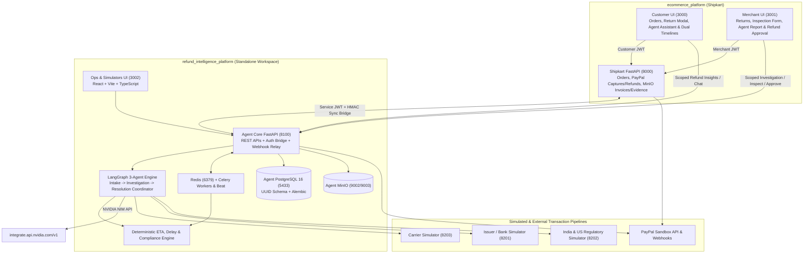

# Agentic Refund Intelligence Platform — Architecture & Connection Specification

**Date:** 2026-11-12  
**Workspace:** `c:\Users\logit\Downloads\Paypal\refund_intelligence_platform\` (Standalone Sibling Platform)  
**Connected Marketplace:** `c:\Users\logit\Downloads\Paypal\ecommerce_platform\` (`Shipkart`)  
**Reference Blueprint:** `C:\Users\logit\Downloads\agentic_refund_intelligence_platform_blueprint.md`  
**Status:** Design Locked (Ready for Plan Review)  

---

## 1. Locked Architectural Decisions

1. **Standalone Workspace + Authenticated Bridge:** `refund_intelligence_platform/` runs as an independent containerized platform with its own PostgreSQL 16 + Alembic schema (`5433`), Redis (`6379`) + Celery workers, MinIO (`9002`/`9003`), FastAPI Agent Backend (`8100`), 3 Simulator FastAPI services (`8201`–`8203`), and React + Vite + TypeScript Operations Console (`3002`), connecting to `ecommerce_platform` (`8000`, `3000`, `3001`) via signed Service JWT + HMAC webhooks.
2. **Strict Human-in-the-Loop Refund Authority (`REF-001`):** No AI agent can independently approve or disburse funds. Agents ingest evidence, reconstruct timelines, evaluate policy/ETA/delays, and queue recommendations (`MERCHANT_APPROVAL_PENDING`); **only explicit Merchant approval (`refund_approvals` + Shipkart Merchant UI)** triggers PayPal refund execution via original `paypal_capture_id`.
3. **LLM Runtime (NVIDIA NIM Free Tier):** Replace blueprint `Gemini API` with NVIDIA NIM (`https://integrate.api.nvidia.com/v1` via `langchain-nvidia-ai-endpoints` `ChatNVIDIA` + Pydantic `with_structured_output`):
   - Reasoning / Structured Planning: `meta/llama-3.3-70b-instruct` (configurable via `NVIDIA_REASONING_MODEL`)
   - Vision / Multimodal Evidence Analysis: `meta/llama-3.2-90b-vision-instruct` (configurable via `NVIDIA_VISION_MODEL`)
   - Deterministic Fallback Mode: If `NVIDIA_API_KEY` is blank in local tests/CI, agents switch cleanly to deterministic rule-based extraction (`model_name="deterministic-fallback"`) while maintaining 100% schema fidelity without blocking development.
4. **Separated Physical vs. Financial Lifecycles:** Physical product return (`return_cases`, `return_case_items`, `return_shipments`, `return_inspections`) and financial refund (`refund_cases`, `refund_transactions`, `refund_approvals`, `refund_timeline_events`) stay cleanly decoupled with independent states.
5. **Truthfulness, Precision & Simulation Transparency:**
   - All financial amounts use PostgreSQL `NUMERIC(18, 2)` and Python `Decimal` (zero `Float`), separating original display currency (`INR`) from PayPal settlement currency (`USD`).
   - Unknown/missing data returns `UNKNOWN` / `NOT_ESTIMABLE` — never fabricated tracking events, bank confirmations, or legal approvals.
   - Carrier, Issuer/Bank, and India/USA Regulatory responses always include `is_simulated: true` and are visibly badged `"SIMULATED"` across APIs and UIs.

---

## 2. System Topology & Shipkart Connection Bridge

### How Real Shipkart Transactions Connect to the Simulated Pipeline
1. **Checkout & Real PayPal Sandbox Capture (`ecommerce_platform`):** Customer buys items via Shipkart `Checkout.jsx`. Shipkart stores `Order` (`INTEGER` PK), `OrderItem` (`merchant_id`, `price`), `MerchantOrderAllocation`, `paypal_order_id`, `paypal_capture_id`, `paypal_currency="USD"`, `paypal_amount`, and MinIO invoice (`INV_{order}.pdf`).
2. **Authenticated Bridge Sync (`ecommerce_platform` ↔ `refund_intelligence_platform`):**
   - Shipkart returns (`POST /api/v1/returns/`) and customer complaint submissions notify Agent Core `POST /api/v1/bridge/shipkart/return-event` signed with `X-Bridge-Signature` (HMAC-SHA256 using `BRIDGE_SHARED_SECRET`).
   - Agent Core queries Shipkart `GET /api/v1/orders/{id}/bridge-context` & streams MinIO evidence/invoice bytes (`GET /api/v1/media/files/...`) using `Authorization: Bearer <SERVICE_JWT>`, computes SHA-256 hashes, verifies magic-byte MIME content (`JPEG`/`PNG`/`PDF`), and maps integer Shipkart IDs (`shipkart_order_id`, `shipkart_order_item_id`, `shipkart_return_id`, `shipkart_customer_id`, `shipkart_merchant_id`) onto UUID `return_cases` and `refund_cases`.
3. **Connected Downstream Verification & Simulation Pipeline:**
   - **Carrier Pipeline (`8203`):** Seeds deterministic shipment tracking (`TRACK-SK-...`) tied to `return_case_id` (`PICKUP_SCHEDULED` → `PICKED_UP` → `IN_TRANSIT` → `DELIVERED_TO_MERCHANT`), with fault scenario triggers (`pickup_overdue`, `stalled_in_transit`, `lost_package`).
   - **PayPal Sandbox Pipeline:** Investigation Agent queries PayPal `/v2/payments/captures/{id}` and `/v2/payments/refunds/{id}`; Merchant human approval on Shipkart/Merchant API dispatches refund strictly via Shipkart's idempotent PayPal refund executor (`POST /api/v1/returns/{id}/execute-approved-refund`) after checking `approval_id` + remaining capture balance.
   - **Bank / Card Issuer Simulator (`8201`):** Links each `paypal_capture_id` / `paypal_refund_id` to masked synthetic card/rail metadata (`VISA` / `MASTERCARD` / `AMEX` / simulated `ARN`) across all **8 blueprint scenarios** (`NORMAL_POSTING`, `DELAYED_POSTING`, `REFERENCE_MISMATCH`, `MISSING_REFERENCE`, `DUPLICATE_CREDIT`, `REPLACED_CARD`, `ISSUER_UNAVAILABLE`, `INSUFFICIENT_EVIDENCE`). Demonstrates `PayPal = COMPLETED` alongside `Bank Credit = ISSUER_CREDIT_PENDING`.
   - **India & USA Regulatory Rules Simulator (`8202`):** Evaluates transaction jurisdiction metadata (`merchant_country`, `customer_country`, `payment_route="CROSS_BORDER"`, `transaction_currency="USD"`, `refund_delay_hours`) against versioned RBI FEMA / India E-Commerce CPA 2019 & US FTC / Reg-E rulesets, flagging `APPLICABLE`, `POTENTIALLY_APPLICABLE`, `MANUAL_REVIEW_REQUIRED`, or `UNKNOWN` (`is_simulated: true` + non-legal disclaimer).

---

## 3. Core Database Schema (`refund_intelligence_platform/agent_backend` — PostgreSQL + Alembic)

All tables use `UUID` PKs, `TIMESTAMPTZ` UTC timestamps, and `NUMERIC(18, 2)` money columns. Core entities per Blueprint Section 8:
- `return_cases` (with `shipkart_return_id`, `shipkart_order_id`, `shipkart_customer_id`, `shipkart_merchant_id`, `reason_code`, `status`)
- `return_case_items` (`shipkart_order_item_id`, `quantity_requested`, `quantity_approved`, `condition_reported`, `condition_inspected`, `refund_amount_requested`, `refund_amount_approved`)
- `return_shipments` (`carrier_name`, `tracking_number`, `status`, `pickup_at`, `delivered_at`, `is_simulated`)
- `return_inspections` (`inspector_id`, `inspection_status`, `condition_result`, `notes`, `completed_at`)
- `refund_cases` (`return_case_id`, `shipkart_order_id`, `case_type`, `status`, `requested_amount`, `approved_amount`, `original_currency`, `paypal_currency`, `paypal_capture_id`)
- `refund_transactions` (`refund_case_id`, `paypal_capture_id`, `paypal_refund_id` [unique nullable], `amount`, `currency`, `status`, `idempotency_key` [unique], `paypal_response` JSONB)
- `refund_approvals` (immutable log: `refund_case_id`, `merchant_user_id`, `decision`, `approved_amount`, `reason`, `policy_version`, `created_at`)
- `evidence` (`return_case_id`, `refund_case_id`, `file_name`, `storage_key`, `mime_type`, `file_size`, `sha256_hash`, `source_type`, `verification_status`, `extracted_metadata` JSONB)
- `refund_timeline_events` (dual timestamps `occurred_at` vs `recorded_at`, `source_type`, `verified`)
- `agent_executions` (`case_id`, `agent_name`, `status`, `input_reference`, `output_data`, `model_name`, `prompt_version`, `started_at`, `completed_at`, `error_code`)
- `agent_decisions` (`execution_id`, `decision_type`, `recommendation` JSONB, `evidence_references` JSONB, `confidence` `NUMERIC(5,4)`, `requires_approval=True`, `decision_status`)
- `refund_eta_estimates` (`refund_case_id`, `earliest_at`, `latest_at`, `confidence_level`, `basis` JSONB, `is_current`)
- `refund_followups` (`refund_case_id`, `target_type`, `scheduled_at`, `status`, `action_type`, `attempt_count`)
- `issuer_inquiries`, `regulatory_evaluations`, `compliance_violations`, `audit_logs` (append-only DB protections), `processed_webhook_events` (unique `(provider, provider_event_id)`).

---

## 4. Three-Agent LangGraph Orchestration & Guardrails

1. **Agent 1 — Intake & Evidence Agent (`intake_agent.py`):**
   - Classifies complaint (`RETURN_REFUND_DELAY`, `DAMAGED_ITEM`, `DUPLICATE_CHARGE`, `CANCELLED_ORDER`, `PARTIAL_REFUND`), verifies attached MinIO files via magic-byte & size checks + SHA-256 + NVIDIA NIM Vision extraction, detects duplicates, cleanly separates `customer_reported_information` from `verified_information`, and flags `missing_information`.
2. **Agent 2 — Investigation Agent (`investigation_agent.py`):**
   - Queries Shipkart Order/Payment Bridge, Carrier Simulator tracking, Merchant inspection status, PayPal Capture/Refund/Webhook verification APIs, Issuer Simulator status, and Regulatory Simulator rules. Builds a deduplicated chronological timeline, identifies `delay_owner` (`MERCHANT` | `CARRIER` | `PAYPAL` | `ISSUER_OR_BANK` | `UNKNOWN`), detects overdue stages (`DELAY-001`..`DELAY-006`), and delegates ETA computation strictly to deterministic `eta_service.py` (never letting the LLM guess dates!).
3. **Agent 3 — Resolution Coordinator Agent (`resolution_agent.py`):**
   - Produces structured recommendations (`REQUEST_EVIDENCE`, `QUEUE_MERCHANT_APPROVAL`, `INITIATE_ISSUER_INQUIRY`, `ESCALATE_COMPLIANCE_REVIEW`), schedules Celery follow-ups, generates grounded customer explanations distinguishing PayPal completion from unconfirmed bank posting, and **strictly sets `requires_approval=True`** on every financial recommendation.
4. **Hard Compliance & Authorization Guard (`compliance_service.py`):**
   - Enforces `REF-001` (Merchant approval row verified in DB), `REF-002` (approved amount ≤ captured minus prior completed/pending refunds), `REF-003` (idempotency lock), `REF-004` (original PayPal capture verified), `AUTH-001`/`AUTH-002`, `SEC-001`/`SEC-002` (redaction + zero PAN/CVV), `CASE-001`, `AUD-001`, `DATA-001`.

---

## 5. Multi-Frontend User Surfaces

1. **Operations & Simulators TypeScript Console (`ops_frontend`, `http://localhost:3002`):**
   - Routes covering Blueprint Section 13.3: `/operations/dashboard`, `/operations/cases`, `/operations/agents`, `/operations/integrations`, `/operations/eta`, `/operations/issuer-simulator`, `/operations/regulatory`, `/operations/compliance`, `/operations/audit`.
   - Allows interactive testing of Carrier delays, all 8 Issuer Bank delay/error scenarios, and India/USA Regulatory rule evaluations side-by-side with live LangGraph agent traces.
2. **Connected Panels Inside Existing Shipkart Portals:**
   - **Customer Storefront (`3000`):** Dual timelines (Physical Return vs Financial Refund), deterministic ETA card with confidence/basis & disclaimer, live Agent Investigation summary ("why your refund is at X stage"), and interactive Customer Refund Assistant chat + Appeal form scoped strictly to own orders.
   - **Merchant Seller Hub (`3001`):** Agent Investigation brief on return claims, Carrier & Warehouse Inspection form, and explicit **Merchant Approve / Reject / Request Evidence** actions tied to `refund_approvals` before PayPal execution.

